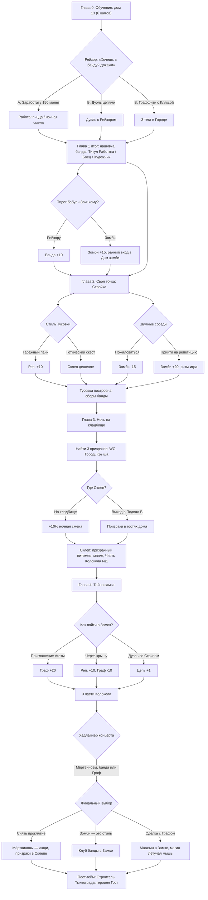

# PUNK ME — Техническое задание: сценарии, задания и локации

**Жанр:** браузерный 3D-мультиплеер, панк/хэллоуин life-sim для подростков (13+)
**Версия документа:** 1.0 (20.10.2026) · **Владелец продукта:** Инна Краг
**Цель документа:** сделать игру понятной. В каждой локации игрока зовут персонажи, дают задания, выбор игрока определяет, куда идти дальше; на стройке есть подсказки; нет денег — идёшь работать, как в жизни.

---

## 0. Принципы (обязательны для всех задач)

1. **Игроку всегда понятно, что делать дальше.** Панель цели показывает одно конкретное действие («Иди к Рейзору в NEON SHOP»), а не абстракцию («Развивайся»).
2. **Каждая локация живая.** В каждой есть минимум 1 NPC, который сам зовёт игрока, и минимум 2 задания.
3. **Выбор имеет последствия:** меняет репутацию, отношение банды, открывает разные локации/квесты. Плохих концовок нет — есть разные.
4. **Деньги — как в жизни:** не хватает — работа. Игра сама подсказывает, где ближайшая работа, и ставит маяк.
5. **Голос — только качественный.** Базовый уровень для ВСЕХ реплик: текстовый пузырь над персонажем + субтитры внизу экрана + короткий невербальный звук (свист, «Эй!», смешок, звон цепи). Озвучка добавляется только там, где есть качественная запись живого актёра или студийного уровня. Дешёвый «рубленый» синтез речи **запрещён**. Если для реплики нет качественного голоса — она идёт без голоса, только пузырь + звук-сигнал.
6. **Возраст 13+:** без крови, жестокости, страшных скримеров. Призраки милые, зомби смешные, драки цепями — спортивные дуэли «до сбитого HP», без травм. Тон — панк-юмор, самоирония.
7. **Используем существующие системы:** монеты, XP, уровень, репутация, стат «Цепь», квестовая цепочка с панелью цели, маяки, «!» над NPC, подсказка «E — говорить», порталы с подписью, ежедневные задания (3/день), магазин, работы, интерактивы, дуэль, декор комнаты, чат банды, RU/EN/DA. Новое в этом ТЗ — контент (квесты, диалоги, NPC, локации) и три системы-надстройки: подсказки, стройка, данные диалогов.

---

## 1. Основной цикл и экономика

### 1.1. Основной цикл (core loop)

```
Позвал NPC → Получил задание → Цель на панели + маяк → Выполнил (иногда нужен выбор)
   → Награда (монеты / XP / репутация / материалы) → Потратил (стройка, одежда, питомец, декор)
   → Открылась новая локация / задание → снова позвал NPC
Не хватает монет? → Подсказка «Иди работать» → Работа (смена 2–4 мин) → Монеты → обратно к цели
```

### 1.2. Потребности (лёгкие, без наказаний)

Только **две** шкалы, чтобы не превращать игру в «кормление тамагочи»:

| Шкала | Падает | Восстанавливается | Если на нуле |
|---|---|---|---|
| **Энергия** (0–100) | −10 за смену на работе, −5 за дуэль, −1 за 1 мин паркура | Холодильник (Кухня) +25, диван +2/сек, автомат с едой (Город) +15, пирог бабули Зои +40 | Нельзя взять работу и дуэль; подсказка: «Ты выдохся. Перекуси на Кухне или в автомате» + маяк |
| **Настроение** (0–100) | −2 за 10 мин без развлечений | Аркада, ТВ, музыкальный автомат, игра с питомцем, концерт на крыше | Ниже 20 — оплата за работу −10%; подсказка «Скучно! Поиграй со щенком или в аркаду» |

Голод отдельно **не** вводится — еда восстанавливает энергию. Ничто не «умирает» и не теряется.

### 1.3. Источники денег

| Источник | Где | Время | Оплата | Доп. награда |
|---|---|---|---|---|
| Доставка пиццы (есть) | Город | смена 3 мин | 40–70 монет (10 за заказ + чаевые за скорость) | +15 XP |
| Ночная смена на кладбище (есть) | Кладбище | смена 4 мин | 60–90 монет (5 за свечу, 10 за призрака) | +20 XP, шанс «Эктоплазма» (материал) |
| Подсобник на стройке (новая) | Стройка | смена 3 мин | 45 монет | +2 доски, +15 XP |
| Расклейка флаеров (новая) | Улица банды | смена 2 мин | 30 монет | +5 репутации |
| Мойка посуды у бабули Зои (новая) | Кухня | смена 2 мин | 25 монет | пирог (+40 энергии) |
| Сбор металлолома (новая) | Крыша / Паркур | свободно, 2–3 мин | 0 монет | 3–6 ед. металлолома, 1–2 доски |
| Аркада (мини-игра) | Комната | 1 мин | 5–20 монет (по очкам, лимит 100/день) | +Настроение |
| Задания сюжета | везде | — | 30–200 монет | XP, материалы, предметы |
| Ежедневные задания | панель | — | 3×(25–50) монет | + бонус за все 3: 50 монет |
| Продажа металлолома | Скобяная лавка | — | 3 монеты/ед. | — |

**Рост оплаты:** уровень работы (1–5) растёт каждые 5 смен; +10% оплаты за уровень. Подписка 4,99 €/мес **не увеличивает** оплату (без pay-to-win) — даёт косметику, второй слот чертежа, эксклюзивный декор и питомцу аксессуар месяца.

### 1.4. Траты денег

| Категория | Примеры | Цена (монеты) |
|---|---|---|
| Стройматериалы | Доска 10, Гвозди (пачка) 5, Кирпич 8, Цепь 15, Баллончик краски 12, Неон-трубка 25, Каменный блок 20, Свеча 3 | см. §4 |
| Мебель/декор | Пуф-череп 60, Постер «Ржавые Цепи» 40, Неоновая вывеска 150, Гитара-декор 120, Кровать-гроб 300 | 40–400 |
| Одежда | Футболка 50, Кожанка с шипами 250, Ирокез-парик 120, Ботинки-гриндеры 180, Ошейник с шипами 70 | 50–300 |
| Питомец | Мяч 20, Миска 30, Лакомство 10 (+счастье 15), Лежанка 90, Костюм-тыква 150 | 10–150 |
| Взнос в общак банды | добровольно; улучшения Тусовки | 50–500 |
| Проезд в автобусе | быстрый переезд Город ↔ Кладбище/Замок | 5 |

**Квартплаты нет** (обязательные периодические списания в 13+ вызывают тревогу и отток). Вместо этого — **добровольный общак банды**: из него строятся улучшения Тусовки, вкладчики получают репутацию.

### 1.5. Сценарий «Нет денег → иду работать» (обязательная реализация)

1. Игрок пытается купить материал / вещь из цели, монет не хватает.
2. Кнопка «Купить» неактивна, под ней: **«Не хватает 35 монет. Заработай на работе →»**.
3. Панель цели временно показывает подцель: **«Заработай 35 монет: доставка пиццы (Город) — ~3 мин»**. Выбирается ближайшая доступная работа (по пути порталов) с учётом энергии.
4. Ставится маяк на NPC-работодателя, у NPC появляется значок «$».
5. Работодатель сам окликает при приближении: «Эй, нужны деньги? Есть смена!» (пузырь + свист).
6. После смены экран итогов: «+52 монеты. До цели осталось 0 — вернись в Скобяную лавку» + маяк обратно.
7. Если энергия < 10 — сначала подцель «Перекуси» (холодильник / автомат), потом работа.

### 1.6. Таблица баланса (ориентир для v1, правится по телеметрии)

| Параметр | Значение |
|---|---|
| Стартовые монеты | 100 |
| Средний доход за 10 мин игры (работа + задания) | 150–200 монет |
| Стоимость материалов Тусовки (этап 1–4) | ≈ 450–470 монет (или часть материалами из заданий/лома) |
| Стоимость Склепа | ≈ 380 монет + 10 эктоплазмы (+100, если чертёж куплен) |
| Время до постройки Тусовки (новичок) | 35–50 мин игры |
| XP на уровень | 100 × уровень (ур.2 = 200 XP суммарно и т.д.) |
| Лимит аркады | 100 монет/день |
| Смена: пицца / кладбище / стройка / флаеры / посуда | 3 / 4 / 3 / 2 / 2 мин |
| Оплата за смену (ур. работы 1) | 40–70 / 60–90 / 45 / 30 / 25 |
| Энергия за смену | −10 (все работы) |
| Кулдаун одной работы | нет (можно подряд, пока есть энергия) |
| Репутация: уровни | 0 «Никто», 50 «Свой», 150 «Панк», 300 «Легенда района» |
| Отношение банды «Ржавые Цепи» | −100…+100, старт 0 |
| Отношение семьи Мёртвиновых | −100…+100, старт 0 |
| Отношение Графа Нетопырёва (Глава 4) | −100…+100, старт 0 |

---

## 2. Сюжетная рамка

**Место действия:** Тыквоград — городок, где Хэллоуин не заканчивается. Игрок живёт в доме №13 (своя Панк-комната, Кухня, SPOOKY WC, Лифт на 13-й этаж, выход на Крышу). Рядом — Улица банды с NEON SHOP, Город, Кладбище, а на холме — заброшенный Готический замок. По соседству въезжает семья зомби Мёртвиновых.

**Банда:** «Ржавые Цепи». Лидер — **Рейзор** (чёрные волосы, худи с черепом; NPC-квестодатель в NEON SHOP, если игрок выбрал другого героя). У банды нет своего места — их гоняют отовсюду.

**Тайна:** 50 лет назад в замке Граф Нетопырёв устроил Великий Хэллоуин-бал. Группа «Мёртвый Сезон» (это и есть Мёртвиновы) сыграла так громко, что треснул Колокол замка. С тех пор семья — милые зомби, а призраки кладбища не могут «успокоиться» и бродят по городу, теряясь. Чтобы всё исправить, нужно собрать сломанные части Колокола и устроить новый концерт.

### Главы

| Глава | Название | Цель игрока | Ключевые локации | Финал главы |
|---|---|---|---|---|
| 0 | Обучение «Новенький в доме 13» | Существующая цепочка из 6 шагов: комната, кухня, щенок, лифт, улица, знакомство с Рейзором | Комната, Кухня, WC, Лифт, Улица | Рейзор: «Хочешь в банду? Докажи» |
| 1 | «Прописка» | Вступить в «Ржавые Цепи»: заработать взнос 150 монет **или** выиграть дуэль цепями у Рейзора; выполнить 2 задания банды | Улица, Город, Кладбище | Игрок получает нашивку банды. Рейзор: «Нам нужна своя точка» |
| 2 | «Своя точка» | Построить Тусовку банды на Стройке (чертёж, материалы, 4 этапа). Познакомиться с соседями-зомби | Стройка, Город, Крыша, Паркур, Дом зомби | Тусовка открыта → сборы банды. Дочь зомби Зомбина находит кусок Колокола |
| 3 | «Ночь на кладбище» | Узнать, почему теряются призраки; построить Склеп для призраков; получить призрачного питомца | Кладбище, Склеп, Стройка | Хранительница Склепа указывает на Замок |
| 4 | «Тайна замка» | Проникнуть в замок, собрать 3 части Колокола, решить судьбу Графа и Мёртвиновых, устроить концерт | Замок, Дом зомби, Крыша | Одна из 3 концовок + открытие свободной стройки города (пост-гейм) |

### Концовки главы 4 (все «хорошие», разные награды)

- **«Снять проклятие»** — Колокол починен, Мёртвиновы снова люди (но остаются панками), призраки уходят в Склеп. Награда: скин «Колокольный звон», Зомбина — новая героиня-NPC в банде.
- **«Зомби — это стиль»** — семья решает остаться зомби; замок становится клубом банды. Награда: локация «Клуб в замке», костюм зомби-панка.
- **«Сделка с Графом»** — игрок помогает Графу открыть ночной магазин в замке. Награда: скидка 20% в замке, плащ Графа, магия «Летучая мышь» (декоративная).

Пост-гейм: «Строитель Тыквограда» — свободные участки, ежедневные задания жителей, дуэли с бандами-соперниками («Синие Шнурки»), новая героиня **Гост** (девочка с фиолетово-чёрными шипами и юбкой в клетку) открывается после квеста на Паркуре.

---

## 3. Локации: NPC, оклики, задания, выборы, работы

**Условные обозначения.** ⚑ — маяк (куда ставится стрелка/луч). «Цель:» — точный текст в панели цели. **Выбор** → последствия. Реп. — репутация, Банда — отношение «Ржавых Цепей», Зомби — отношение Мёртвиновых. Все реплики — пузырь + субтитры; 🔊 — разрешена озвучка, если есть качественная запись.

**Общие правила оклика (для всех NPC):**
- Триггеры: `proximity` (игрок в радиусе N м), `enter` (вход в локацию), `time` (время суток/таймер), `quest_state` (стадия квеста), `need` (нет денег, нет энергии).
- При срабатывании: невербальный звук (свист / «Эй!» / звон цепи / бульк), пузырь над NPC, над NPC — «!», если NPC за кадром — **индикатор направления** по краю экрана с иконкой лица NPC.
- Кулдаун одного оклика — 90 с; одновременно окликает не больше 1 NPC (приоритет: сюжет > работа при нехватке денег > побочные > ежедневные).

### 3.1. Панк-комната (дом игрока) — `loc_room` — существует

**Зачем:** дом, база, декор, отдых, питомец, гардероб, аркада.

| NPC | Кто | Характер |
|---|---|---|
| Щенок **Шнурок** (имя меняется) | чёрно-белый щенок с ошейником-черепом | преданный, гавкает, приносит мяч; «говорит» иконками-эмоциями |
| **Мама Лида** | голос из-за двери (её не видно) | бывшая рокерша, заботливая, ворчит про бардак, шутит |

**Оклик:** `enter` при первом входе за день → стук в дверь + пузырь у двери: **«Подъём, звезда панка! Шнурок уже десять минут сидит у миски!»** Щенок при `proximity 3 м` и счастье < 50: лай + иконка мяча.

**Задания:**
1. **«Утро панка»** (ежедневное). Шаги: накорми щенка (⚑ миска) → брось мяч 3 раза (⚑ щенок) → погладь. Цель: «Накорми Шнурка — подойди к миске и нажми E». Награда: +20 счастья питомца, +10 XP.
2. **«Комната — лицо панка»** (Глава 1). Мама: «Это комната или склад гитарных струн?» Шаги: открой режим декора (⚑ кнопка «Декор») → поставь 1 постер и 1 предмет мебели. **Выбор** в финале:
   - «Ладно, приберусь» → +20 монет от мамы, +10 Настроения.
   - «Это не бардак, это стиль!» → +5 Реп., мама: «Стиль… ну, хотя бы пыль протри». Открывается побочка «Громче!» (поставь музыкальный автомат на максимум — соседи-зомби стучат в стену → ранний вход в Дом зомби).
3. **«Рекорд Рейзора»** (Глава 1, побочное). На аркаде записка: «RZR — 500. Слабо?». Цель: «Набери 500 очков в аркаде». Награда: 50 монет, +1 к стату «Цепь» на следующей дуэли (бафф «Разогрет»).

**Работа:** нет (аркада — мини-заработок до 100 монет/день).
**Интерактивы:** диван (энергия), ТВ (новости Тыквограда = подсказки по сюжету), музыкальный автомат (Настроение), аркада, шкаф (гардероб), кровать-гроб (декор), миска и лежанка щенка, дверь-портал «Кухня / Лифт».
**Награды:** декор, баффы Настроения, ежедневная забота о питомце.

### 3.2. Кухня — `loc_kitchen` — существует

**Зачем:** еда/энергия, мини-работа, сюжетные зацепки от бабули.

| NPC | Кто | Характер |
|---|---|---|
| **Бабуля Зоя** | бывшая барабанщица группы «Ржавые Бабки», печёт тыквенные пироги | бодрая, говорит рифмами, знает тайны Тыквограда |

**Оклик:** `proximity 6 м` → звон половника + **«Эй, панчонок! Пирог стынет, а бабушка скучает!»** 🔊

**Задания:**
1. **«Пирог для банды»** (Глава 1). Шаги: возьми тыкву из холодильника (⚑ холодильник) → купи специи в автомате Хрустомат в Городе (⚑ портал «Лифт → Город», 5 монет) → испеки (⚑ плита, мини-игра «помешай»: 3 нажатия в такт). **Выбор:** кому отдать пирог:
   - Рейзору → Банда +10, открывает побочку «Пиццерия против пирога».
   - Соседям-зомби → Зомби +15, раньше открывается Дом зомби, Зомбина зовёт в гости.
   - Себе → +40 энергии, бабуля: «Эгоист, но честный».
2. **«Барабанные палочки»** (Глава 4). Бабуля узнаёт фото группы «Мёртвый Сезон»: «Я же с ними на том балу играла!». Цель: «Принеси бабуле фото из Дома зомби». **Выбор:** «Расскажи всё» → бабуля даёт **Часть Колокола №2 — Язык** (сократить поиски); «Промолчи» → бабуля даёт 100 монет и рецепт «Пирог силы» (+60 энергии).

**Работа «Мойка посуды»** (новая, 2 мин, 25 монет + пирог): 1) подойди к раковине (⚑), E; 2) тарелки появляются по одной, зажми ЛКМ/палец и «три» пятно (3 сек на тарелку); 3) расставь на сушилку (перетащить); 4) итоги: 8+ тарелок = полная оплата, разбитая = −3 монеты.
**Интерактивы:** холодильник (+25 энергии, перекус), плита, стол (сесть), радио.
**Награды:** энергия, рецепты, сюжетная часть Колокола.

### 3.3. Туалет «SPOOKY WC» — `loc_wc` — существует

**Зачем:** юмор, первая зацепка «потерянных призраков», зеркало-причёски.

| NPC | Кто | Характер |
|---|---|---|
| **Призрак Плюх** | милый призрак, живёт в бачке | драматичный, боится вантузов, вежливый |

**Оклик:** `enter` → дребезг крышки бачка + бульк + **«Пс-с! Только не смывай! Я тут живу… временно… уже лет пятьдесят.»**

**Задания:**
1. **«Потерянный призрак»** (Глава 1, побочное → важно для Главы 3). Плюх не помнит, откуда он. Шаги: посмотри в зеркало (⚑ зеркало: отражение показывает кладбище) → спроси Плюха → **Выбор:**
   - «Отведу тебя домой» → Плюх летит за игроком до Кладбища (⚑ портал «Улица → Город → Кладбище»); Кладбище открывается раньше, +20 XP, Сторож дарит фонарь.
   - «Оставайся, будешь соседом» → Плюх даёт 10 монет/день («нашёл в трубах»), в Главе 3 он сам станет первым жителем Склепа (+скидка 10% на материалы Склепа).
2. **«Сантехник-экзорцист»** (ежедневное повторяемое). Течёт кран, Плюх нервничает. Шаги: найди гаечный ключ (на Крыше ⚑ ящик, или купи у Дяди Болта за 15) → почини (мини-игра: 3 поворота в нужный момент). Награда: 30 монет, +5 Реп.

**Работа:** нет. **Интерактивы:** зеркало (смена причёски бесплатно; цвет ирокеза — магазин), раковина, смыв (смешной звук, Плюх возмущается), лампа-мигалка.
**Награды:** доступ к Кладбищу раньше, пассивный доход 10/день, скидка на Склеп.

### 3.4. Лифт (13 этаж) — `loc_elevator` — существует

**Зачем:** хаб быстрых перемещений; кнопки = порталы с подписями: «13 — Комната», «1 — Улица банды», «R — Крыша», «Б — Подвал» (закрыт до Главы 3).

| NPC | Кто | Характер |
|---|---|---|
| **Лифтон** | говорящий лифт (динамик + лампочки-«глаза») | артист, драматизирует каждую поездку |
| **Консьержка Агата** | гот-бабушка в лифтовом холле, вяжет чёрные шарфы | строгая, но добрая, знает всех жильцов |

**Оклик:** игрок в лифте и бездействует 5 с → **«Этаж? Только не говори "любой" — я этого не выношу.»** Агата при `proximity 4 м`: **«Опять без шарфа? Простудишь свой ирокез.»**

**Задания:**
1. **«Застрявший лифт»** (Глава 1). Лифт «застревает» между этажами. Цель: «Нажми кнопки в порядке, который подсказывает Агата». Агата через решётку называет 4 кнопки (на экране — подсказка-последовательность, при ошибке подсветка нужной). Награда: 30 монет, Лифтон теперь говорит «Ты мой любимый пассажир».
2. **«Посылка для 14-го»** (Глава 2). Агата: «Отнеси посылку новым соседям». **Выбор:** отнести как есть → Зомби +10, Агата +шарф (аксессуар); заглянуть внутрь → находишь цепь-брелок (+1 «Цепь» на дуэли), но Зомби −10 и Агата: «Некрасиво, панк».
3. **«Подвал Б»** (Глава 3). Ключ от Сторожа Кладбища открывает кнопку «Б»: в подвале тоннель к Склепу (короткий путь, портал «Подвал → Склеп»).

**Работа:** нет. **Интерактивы:** кнопки этажей (порталы), зеркало в лифте (селфи → пост в чат банды), музыка в лифте (переключение).
**Награды:** быстрые перемещения, аксессуар-шарф, короткий путь в Склеп.

### 3.5. Улица банды (NEON SHOP) — `loc_gang_street` — существует

**Зачем:** центр социальной жизни: банда, магазин одежды, дуэли, флаеры.

| NPC | Кто | Характер |
|---|---|---|
| **Рейзор** | лидер «Ржавых Цепей», худи с черепом | колючий, ироничный, честный, проверяет новичков |
| **Неона** | хозяйка NEON SHOP | модница, болтушка, даёт советы по стилю |
| **Клякса** | граффитист банды, в маске-респираторе | молчаливый, рисует, отвечает жестами и надписями |

**Оклик:** Рейзор, `proximity 10 м`, квест «Прописка» не начат → свист + **«Эй, новенький! Да, ты, с причёской. Иди сюда.»** 🔊. Неона при новых товарах: **«Свежая кожа с шипами! Заходи, пока не расхватали!»**

**Задания:**
1. **«Прописка»** (Глава 1, главное). Рейзор: «В банду просто так не берут». **Выбор пути:**
   - **А. «Заработаю взнос»** — цель «Принеси 150 монет в общак» → подсказка ближайшей работы (§1.5). Итог: Банда +10, титул «Работяга».
   - **Б. «Вызываю на дуэль»** — дуэль цепями (Цепь/Блок/Уклон). Победа: Банда +20, «Цепь» +1, титул «Боец». Поражение: «Неплохо. Приходи ещё» — повтор через 60 с, подсказка: «Блок → потом Цепь: Рейзор открывается после атаки».
   - **В. «Нарисую знак банды»** — с Кляксой: купи 3 баллончика (36 монет) → нарисуй тег на 3 стенах в Городе (⚑ 3 стены). Итог: Банда +15, Реп. +10, титул «Художник».
   Финал: нашивка банды на одежду, открыт чат банды, Глава 2.
2. **«Синие Шнурки»** (Глава 1–2). Соперники рисуют свои теги. **Выбор:** закрасить (Банда +10, «Шнурки» −20, открывается дуэль с их лидером Шнурком-старшим) или договориться (Реп. +10, открывается торговец «Шнурков» со скидкой на кеды).
3. **«Пиццерия против пирога»** (побочное, если пирог отдан Рейзору). Рейзор хочет ещё — нужно выбрать: снова к бабуле или заказ у Тони (20 монет).

**Работа «Расклейка флаеров»** (новая, 2 мин, 30 монет, +5 Реп.): 1) возьми пачку у Кляксы (⚑); 2) на мини-карте 8 столбов, маяки по очереди; 3) у столба — E (1 сек); 4) за 8 столбов полная оплата, за каждый лишний 5 монет бонус.
**Интерактивы:** NEON SHOP (магазин одежды/аксессуаров), стена граффити, скамейка, бочка с огнём (Настроение), ринг для дуэлей.
**Награды:** вступление в банду, титулы, одежда.

### 3.6. Город / Район — `loc_city` — существует

**Зачем:** работа, покупки материалов, транспорт.

| NPC | Кто | Характер |
|---|---|---|
| **Тони Корочка** | хозяин пиццерии «Злая Корочка» | громкий, вечно спешит, щедр на чаевые |
| **Дядя Болт** | хозяин Скобяной лавки (ларёк со стройматериалами) | бывший рокер-байкер, объясняет, что для чего нужно |
| **Хрустомат** | говорящий торговый автомат | обидчивый, иногда «съедает» монеты |
| **Водитель Сёма** | водитель ночного автобуса | философ, спокойный |

**Оклик:** Тони — `need: coins < цели` или `proximity 8 м`: гудок мопеда + **«Эй, свободные руки! Пицца сама себя не довезёт!»** 🔊. Дядя Болт — `quest_state: стройка активна`: стук молотка + **«Доски, гвозди, цепи! Строишь что-то? Заходи, покажу!»**

**Задания:**
1. **«Первая доставка»** (Глава 1, обучение работе). Тони объясняет смену → 1 пробный заказ. Награда: 30 монет, работа «Доставка пиццы» открыта.
2. **«Список прораба»** (Глава 2). Список материалов от Прораба. Цель: «Купи 10 досок и 2 пачки гвоздей у Дяди Болта». Если не хватает монет — §1.5.
3. **«Призрак на переходе»** (Глава 3). Призрак Шорох боится машин. Шаги: подойди (⚑ переход) → жди зелёный → проведи (Шорох летит рядом). **Выбор:** посадить на автобус к Кладбищу (5 монет, быстро, Сёма даёт проездной) или пройти пешком через Улицу (Шорох знакомит с духом-граффити, +бесплатный тег-скин).
4. **«Автомат-обидчик»** (побочное). Хрустомат съел монеты. **Выбор:** пнуть (возврат монет + чипсы, Реп. −5, Хрустомат дуется 1 день) или починить ключом (Реп. +5, скидка 20% навсегда).

**Работа «Доставка пиццы»** (3 мин, 40–70 монет): 1) возьми коробку у Тони (⚑ стойка); 2) маяк на адрес (дом, остановка, Улица, крыша-кафе); 3) переходи только на зелёный (штраф −5 за красный, без «аварий»); 4) E у двери — чаевые за скорость (+0–10); 5) 3–5 заказов за смену; 6) экран итогов.
**Интерактивы:** пешеходный переход, автобусная остановка (переезд 5 монет), Хрустомат (снеки +15 энергии), Скобяная лавка, машины (фон).
**Награды:** основной источник денег и материалов.

### 3.7. Кладбище (ночь) — `loc_cemetery` — существует

**Зачем:** ночная работа, призраки, вход к Склепу, сюжет Главы 3.

| NPC | Кто | Характер |
|---|---|---|
| **Сторож Пётр Полночев** | сторож с фонарём | боится темноты (смешно), добрый, засыпает на ходу |
| Призраки **Буся, Шорох, Ух** | милые призраки | Буся — хохотушка, Шорох — пугливый, Ух — любит высоту |

**Оклик:** `enter` → скрип фонаря + **«Кто тут?! А… живой. Слава свечкам. Поможешь старику?»** 🔊. Буся — `proximity 5 м`: хихиканье + «Бу! Ой, испугался? Нет? Обидно.»

**Задания:**
1. **«Первая ночная смена»** (Глава 1, обучение работы). Награда: 40 монет, работа открыта.
2. **«Пропавшие призраки»** (Глава 3, главное). Сторож: «Мои призраки разбежались!». Цель: «Найди 3 призраков: SPOOKY WC (Плюх), Город (Шорох), Крыша (Ух)» — 3 маяка, счётчик 0/3. Награда: 100 монет, +20 XP, Сторож даёт ключ от Подвала Б.
3. **«Дом для призраков»** (Глава 3). Сторож: «Им нужен свой Склеп». **Выбор места:** на Кладбище — классический (призраки +, работа на кладбище даёт +10%) или с выходом в Подвал дома 13 — уютный (призраки навещают Комнату, декор «Призрачный ночник»). Открывает Склеп (§3.11) и чертёж Склепа.
4. **«Танец теней»** (побочное). Тренировочная дуэль с призраком Ух (лёгкая), учит Уклону. Награда: +1 «Цепь».

**Работа «Ночная смена»** (4 мин, 60–90 монет): 1) возьми фонарь у Сторожа; 2) зажги 10 свечей (⚑ ближайшая незажжённая, E), 5 монет каждая; 3) лови шаловливых призраков сачком (подойти + E по таймингу), 10 монет; 4) таймер 4 мин; 5) шанс 20% — 1 «эктоплазма» (материал Склепа).
**Интерактивы:** надгробия (смешные эпитафии: «Здесь лежит мой Wi-Fi»), склепы (закрыты до Гл. 3), туман, фонарь, колокольчик Сторожа.
**Награды:** деньги, эктоплазма, ключ, Склеп.

### 3.8. Крыша — `loc_roof` — существует

**Зачем:** концерты, бесплатные материалы, вид на город и замок, сцена финала.

| NPC | Кто | Характер |
|---|---|---|
| **ДиДжей Чердак (Дима)** | диджей с колонками из мусора | позитивный, мечтает о большом концерте |

**Оклик:** `enter` → скретч пластинки + **«Йо! Ты по лестнице или по воздуху? Кстати, тут полно металлолома — бери, не жалко!»** 🔊

**Задания:**
1. **«Металлолом»** (повторяемое, источник материалов). Цель: «Собери 5 металлолома (светятся)». 5 маяков. Награда: 5 лома, 1 доска.
2. **«Призрак на антенне»** (Глава 3). Ух застрял на антенне. Шаги: поставь ящики (перетащи 2 ящика ⚑) → залезь → уговори. **Выбор:** «Прыгай, я поймаю!» (смешная анимация, Ух +, открывает Паркур-маршрут «Антенна») или «Слезай сам» (Ух обижается, но даёт подсказку о Замке раньше).
3. **«Сцена для концерта»** (Глава 4, финал). Построй сцену (мини-стройка: 6 досок, 2 неон-трубки, 1 колонка от Чердака). **Выбор хедлайнера:** Мёртвиновы (Зомби +30) / банда «Ржавые Цепи» (Банда +30) / Граф с органом (Граф +30, открывает концовку «Сделка»). Влияет на финальный ролик.

**Работа:** сбор лома (материалы, не деньги). **Интерактивы:** колонки Чердака (Настроение), телескоп (видно Замок → маяк сюжета), ящики, антенна, лестница-портал «Паркур».
**Награды:** доски и лом бесплатно, сцена концерта.

### 3.9. Паркур на крышах — `loc_parkour` — существует

**Зачем:** навык, гонки, тайники, открытие героини Гост.

| NPC | Кто | Характер |
|---|---|---|
| **Гост** | девочка с фиолетово-чёрными шипами, юбка в клетку | загадочная одиночка, саркастичная, быстрая |

**Оклик:** `proximity 15 м` → Гост приземляется рядом (шорох + свист) **«Медленно бегаешь. Догонишь — поговорим.»**

**Задания:**
1. **«Догони Гост»** (Глава 2). Гонка по маршруту с чекпоинтами-маяками. Проиграл — повтор, подсказка: «Прыгай с края, не с середины». Победа: Гост называет имя, 50 монет.
2. **«Тайник с чертежом»** (Глава 3). Гост: «Видела на старой трубе свёрток». Маршрут к тайнику → **Чертёж Склепа** (альтернатива покупке за 100 монет у Дяди Болта).
3. **«Фиолетовые шипы»** (Глава 4 / пост-гейм). 3 маршрута на время (60/50/45 с). **Выбор:** позвать Гост в «Ржавые Цепи» (нужно Банда ≥ 20; Банда +10) или создать с ней свою «крышную» команду (Реп. +15, отдельный значок). В обоих случаях Гост открывается как играбельная героиня.

**Работа:** сбор лома на маршрутах (по 1–2 лома, 1 доска). **Интерактивы:** трамплины, трубы, верёвки, тайники, финишный флаг.
**Награды:** доски, чертёж Склепа, героиня Гост.

### 3.10. Стройка / Строитель города — `loc_construction` — НОВАЯ (MVP)

**Зачем:** строительство Тусовки банды (Глава 2), Склепа (Глава 3), объектов города (пост-гейм). Портал: Город → «Стройка».

| NPC | Кто | Характер |
|---|---|---|
| **Прораб Кувалда Михална** | бригадир в каске с наклейками групп | командирша, громкая, объясняет всё по пунктам |
| **Винтик** | стажёр-подросток в огромной каске | неуклюжий, весёлый, подсказывает, где брать материалы |

**Оклик:** `enter` или `quest_state: Глава 2` → гудок крана + **«Каску надень! Ой, нет каски… Ладно, просто не стой под краном. Ты от Рейзора?»** 🔊. Винтик при нехватке материалов: **«Пс! Доски можно бесплатно найти на Крыше. Я тебе там отметил!»**

**Задания:**
1. **«Чертёж Тусовки»** (Глава 2, главное) — полный цикл стройки (§4). **Выбор стиля:** «Гаражный панк» (неон, граффити; Реп. +10, концерты дают +Настроение) или «Готический сквот» (камень, свечи; призраки +, Склеп дешевле на 10%).
2. **«Подсобник»** — первая смена работы, обучение.
3. **«Склеп: фундамент»** (Глава 3) — стройка Склепа (§4.4).
4. **«Мэр-самоучка»** (пост-гейм). Свободные участки Тыквограда: фонари, скамейки, скейт-рампа, тыквенная ярмарка. Каждый объект даёт ежедневное задание жителей.

**Работа «Подсобник»** (новая, 3 мин, 45 монет + 2 доски): 1) возьми каску у Винтика; 2) отнеси 6 досок от грузовика к штабелю (⚑, подбор E, нести — скорость −20%); 3) подай Михалне 3 инструмента по её команде (пузырь с иконкой «молоток/пила/гвозди» → выбери нужный из 3); 4) итоги.
**Интерактивы:** участок под стройку (табличка «Здесь будет…»), стол с чертежами, грузовик с материалами, бетономешалка (смешной звук), кран (декор).
**Награды:** построенные объекты и их бонусы (§4.5).

### 3.11. Склеп — `loc_crypt` — НОВАЯ (Глава 3)

**Зачем:** дом призраков, призрачный питомец, магия, ключ к Замку. Порталы: Кладбище → «Склеп»; Подвал Б → «Склеп».

| NPC | Кто | Характер |
|---|---|---|
| **Леди Сквозняк** | призрак-хранительница в викторианском платье | вежливая, говорит старомодно, любит порядок |
| Призраки Буся, Шорох, Ух, Плюх | жители | см. выше |

**Оклик:** после постройки, `enter` → звон колокольчика + **«О, юный строитель! Позвольте поблагодарить вас… и попросить ещё об одной мелочи.»** 🔊

**Задания:**
1. **«Новоселье призраков»**. Расставь 4 гробика-кровати и 8 свечей (режим декора), каждый призрак говорит «спасибо». Награда: 80 монет, +20 XP.
2. **«Призрачный питомец»**. Леди Сквозняк дарит призрачного щенка. **Выбор цвета/характера:** «Бирюзовый весельчак» (+счастье Шнурку, играют вместе) или «Фиолетовый страж» (светит в темноте, +10% к ночной смене). Шнурок сначала ревнует → мини-задание «Подружи питомцев» (2 мяча, 1 лакомство).
3. **«Голос Колокола»** (Глава 3 → 4). Леди: «Призраки теряются, потому что молчит Колокол Замка». Получи **Часть Колокола №1 — Обод** (лежит в Склепе). Открывается Замок, автобус Сёмы теперь ходит к холму (5 монет).
4. **«Свет свечей»** (магия). Научись заклинанию «Огонёк»: жест (нарисовать круг мышью/пальцем) зажигает свечу на расстоянии. Используется в ночной смене и в Замке.

**Работа:** нет (ночная смена на Кладбище рядом). **Интерактивы:** колокольчик, свечи, гробики-кровати (сесть/лечь — шутка), книга призраков (лор, подсказки).
**Награды:** призрачный питомец, магия «Огонёк», часть Колокола, доступ к Замку.

### 3.12. Готический замок — `loc_castle` — НОВАЯ (Глава 4)

**Зачем:** главная тайна, финал. Портал: автобус Сёмы → «Замок на холме».

| NPC | Кто | Характер |
|---|---|---|
| **Граф Нетопырёв** | вампир-вегетарианец, пьёт томатный сок | театральный, одинокий, обидчивый, любит орган |
| **Дворецкий Скрип** | вежливый скелет (мультяшный) | скрипит суставами, строгий фейс-контроль |

**Оклик:** `proximity 8 м` у ворот → скрип ворот + Скрип: **«Вход только по приглашению. Или по уважительной причине. Ваша причина, юный… панк?»** 🔊

**Задания:**
1. **«Вход по приглашению»**. **Выбор способа:**
   - Пригласительное от Агаты (она бывала на балу; задание «Свяжи шарф для Графа»: 3 мотка ниток по 10 монет) → Граф +20.
   - Через крышу (паркур-маршрут «Антенна», если открыт) → Реп. +10, Граф −10 («Невоспитанно!»).
   - Дуэль цепями со Скрипом (средняя сложность) → «Цепь» +1, Скрип +уважение.
2. **«Три части Колокола»** (главное). №1 Обод — Склеп, №2 Язык — у бабули Зои или в Доме зомби (зависит от выбора), №3 Корона — башня Замка: головоломка «Свечи» (зажги 5 свечей в порядке нот на органе; подсказка: ноты подсвечены при игре на органе). Счётчик 0/3 в панели цели.
3. **«Великий бал»** (финал). Граф признаётся: колокол треснул, потому что он сам запретил группе играть громко и испортил бал. **Финальный выбор** → 3 концовки (§2). Перед выбором показывается текст последствий («Мёртвиновы станут людьми…»), чтобы выбор был осознанным.

**Работа:** «Ночной экскурсовод» (пост-гейм, 3 мин, 60 монет: проведи 3 группы туристов-призраков по маякам и расскажи факт — выбор правильной реплики).
**Интерактивы:** орган (мини-игра ритма), портреты (подсказки), летучие мыши (декор), тронный зал, башня.
**Награды:** концовки, плащ Графа, клуб/магазин в замке, магия «Летучая мышь».

### 3.13. Дом семьи зомби Мёртвиновых — `loc_zombie_house` — НОВАЯ (Глава 2)

**Зачем:** соседи, юмор, вторая сюжетная линия, ритм-мини-игра. Вход: дверь на Улице банды / стук в стену из Комнаты.

| NPC | Кто | Характер |
|---|---|---|
| **Папа Гнилыч** | бас-гитарист, ворчун | любит громкую музыку и тишину одновременно |
| **Мама Тлена** | садовод, выращивает гигантскую капусту | заботливая, всех кормит капустным супом |
| **Зомбина** | дочь, 13 лет, зелёные косички | стеснительная, мечтает в банду, отлично рисует |
| Пёс **Кость** | зомби-пёс (мультяшный) | дружит со Шнурком |

**Оклик:** Зомбина машет из окна, когда игрок проходит по Улице (`proximity 12 м`, Глава 2+): стук в стекло + **«Эй! Ты же из банды? Только не убегай — я не кусаюсь. Почти.»**

**Задания:**
1. **«Шумные соседи»** (Глава 2). Сквозь стену грохочет репетиция. **Выбор:** пожаловаться Агате (Агата +, Зомби −15, тишина) или прийти на репетицию (Зомби +20, открывается ритм-мини-игра «Бас Гнилыча» — 5–20 монет за раунд, лимит 100/день).
2. **«Капуста-монстр»** (повторяемое). Работа на огороде мамы Тлены.
3. **«Зомбина хочет в банду»** (Глава 2). Отведи Зомбину к Рейзору. **Выбор:** поручиться за неё (если Банда ≥ 10: Зомбина в банде, Зомби +20, Банда +5) или «Пусть сама докажет» (Зомбина проходит дуэль, Банда +10, Зомби −5). Зомбина находит **фото группы на балу** и кусок металла (= Часть Колокола №2, если бабуля не дала её раньше).
4. **«Семейный альбом»** (Глава 4). Тлена рассказывает о проклятии. Подсказка → Замок.

**Работа «Огород Тлены»** (новая, 2 мин, 30 монет + капустный суп +30 энергии): 1) лейка (⚑); 2) полей 6 грядок (маяки по очереди); 3) прогони 3 вороны (подойди + E); 4) итоги.
**Интерактивы:** бас-гитара (ритм-мини-игра), холодильник с капустой, диван-гроб, семейный альбом.
**Награды:** отношения Зомби, Зомбина в банде, часть Колокола, ритм-мини-игра.

---

## 4. Система строительства

### 4.1. Как начать стройку
1. Получить **чертёж**: Тусовка — от Рейзора (Глава 2, бесплатно); Склеп — тайник на Паркуре или 100 монет у Дяди Болта; объекты города — у Михалны (30–150 монет).
2. Прийти на **участок** (⚑ табличка на Стройке), нажать **E — «Начать стройку»** → выбрать чертёж и стиль.
3. Открывается **панель стройки** справа: этапы, нужные материалы, сколько есть / сколько нужно, кнопки «Где взять?».

### 4.2. Где брать материалы

| Материал | Купить (Скобяная лавка, Город) | Найти бесплатно | Награда за задания/работы |
|---|---|---|---|
| Доска | 10 | Крыша, Паркур (1–2 за забег) | Подсобник +2, «Металлолом» +1 |
| Гвозди (пачка) | 5 | — | Подсобник (иногда) |
| Кирпич | 8 | — | «Список прораба» +10 |
| Цепь | 15 | — (или переплавить 5 лома у Болта) | дуэли с «Шнурками» +1 |
| Баллончик краски | 12 | — | «Прописка» путь В +1 |
| Неон-трубка | 25 | — | Неона за 3 флаер-смены +1 |
| Каменный блок | 20 | — | «Пропавшие призраки» +5 |
| Свеча | 3 | Кладбище (после смены +2) | ночная смена |
| Эктоплазма | не продаётся | ночная смена (20%) | «Танец теней» +2 |
| Металлолом | продажа 3 | Крыша, Паркур | — |

### 4.3. Тусовка банды (Глава 2) — этапы

| Этап | Нужно | Визуал после этапа | Подсказка в панели |
|---|---|---|---|
| 1. Фундамент | 10 кирпичей, 2 пачки гвоздей | ограждение, разметка, бетон | «Нужно: 10 кирпичей — купи у Дяди Болта в Городе (80 монет) или получи за задание "Список прораба"» |
| 2. Каркас | 10 досок, 2 пачки гвоздей | деревянный каркас, лестница | «Нужно: 10 досок — купи в Городе (10 за шт.), найди на Крыше или заработай сменой "Подсобник" (+2)» |
| 3. Стены и крыша | 8 досок, 6 кирпичей, 2 цепи | стены, крыша из жести, цепи на воротах | «Не хватает 2 цепей — купи (15) или переплавь 5 лома у Дяди Болта» |
| 4. Стиль | Панк: 2 неона + 3 баллончика / Готика: 4 кам. блока + 10 свечей | вывеска «Ржавые Цепи», граффити или свечи, мебель | «Последний шаг! Неон-трубки — в Скобяной лавке или у Неоны» |

Каждый этап: игрок кладёт материалы (E у участка) → мини-анимация стройки 10 с (можно помочь: 5 кликов «молотком» ускоряют до 5 с) → Михална комментирует → +30 XP. Прогресс сохраняется, материалы не теряются.

**Строка подсказки (формат):** `Нужно: {кол-во} {материал} — {где купить} ({цена}) или {где найти/заработать}`. Кнопка «Где взять?» ставит маяк на ближайший источник; если монет нет — включается сценарий §1.5.

### 4.4. Склеп (Глава 3) — этапы
1. Расчистка (бесплатно, мини-задание: убрать 6 кустов и листву) → 2. Фундамент (6 каменных блоков) → 3. Своды (8 кирпичей, 4 цепи) → 4. Убранство (10 свечей, 10 эктоплазмы, 1 витраж — награда «Пропавшие призраки»). Итого ≈ 380 монет + 10 эктоплазмы (+100 за чертёж, если не найден на Паркуре).

### 4.5. Что открывают постройки

| Постройка | Открывает |
|---|---|
| Тусовка банды | Сборы банды (ежедневное групповое задание в мультиплеере), доска заданий банды, общак, декор Тусовки, точка спавна банды |
| Склеп | Призрачный питомец, магия «Огонёк», жители-призраки, Часть Колокола №1, доступ к Замку |
| Сцена на крыше | Финальный концерт, далее — еженедельные концерты (событие, +Настроение всем) |
| Объекты города (пост-гейм) | Фонари (ночью безопаснее — +5% ночная смена), скейт-рампа (мини-игра), ярмарка (новые товары), скамейки (места отдыха) |

---

## 5. Карта выборов и ветвлений



---

## 6. Система подсказок и навигации (правила)

| # | Правило | Реализация |
|---|---|---|
| H1 | Панель цели **всегда** показывает следующее действие одним глаголом | Формат: `{глагол} {что} — {где}`: «Купи 10 досок — Скобяная лавка, Город». Пустая панель запрещена: если сюжетных целей нет — ежедневное задание или «Загляни на Улицу банды: Рейзор что-то хочет». |
| H2 | Маяк на цель | Луч/стрелка над целью в текущей локации; если цель в другой локации — маяк на **портал** с подписью «→ Город». |
| H3 | Застрял > 60 с | Если 60 с нет прогресса по цели (нет шага, нет подхода к маяку ближе 5 м): пузырь-подсказка от ближайшего «своего» NPC или щенка (лай + иконка) + усиление маяка (пульсация). После 120 с — подсказка конкретнее («Нажми E у холодильника»). После 180 с — кнопка «Показать путь» (линия на земле). |
| H4 | Не хватает монет для цели | Автоматически: подцель «Заработай N монет», выбор ближайшей доступной работы (по числу порталов, с учётом энергии ≥ 10), маяк на работодателя, работодатель окликает (§1.5). |
| H5 | Не хватает энергии | Подцель «Перекуси»: ближайший холодильник / Хрустомат / пирог бабули. |
| H6 | Оклик NPC вне экрана | Индикатор направления по краю экрана: иконка лица NPC + «!» (сюжет, жёлтый), «$» (работа, зелёный), «?» (побочное, синий). Исчезает после разговора или через 30 с. |
| H7 | Выбор с последствиями | В окне выбора под каждым вариантом — короткая строка последствий иконками: «Банда ▲», «Зомби ▼», «→ откроет Кладбище». |
| H8 | Ошибка/провал без наказания | Проиграл дуэль/гонку — сразу совет и кнопка «Ещё раз». |
| H9 | Отключение подсказок | В настройках: «Подсказки: Полные / Минимальные (только H1, H2, H4)». Отключить H1 нельзя. |
| H10 | Голос и звук | Каждый оклик = невербальный звук (≤ 1 с) + пузырь + субтитры. Голосовая реплика проигрывается, только если у реплики есть `voice` с качеством `studio`. Без голоса — без TTS. |

---

## 7. Формат данных диалогов и заданий (JSON)

### 7.1. Схема (сокращённо)

```json
{
  "dialogue": {
    "id": "string — уникальный, напр. dlg_razor_initiation",
    "location": "loc_*",
    "trigger": { "type": "proximity|enter|time|quest_state|need", "radius_m": 10,
                 "conditions": ["quest:q_tutorial=done", "flag:!joined_gang"] },
    "callout": { "sound": "sfx_whistle", "icon": "!", "bubble_key": "line id" },
    "nodes": [
      {
        "id": "n1",
        "speaker": "npc_razor | player | npc_*",
        "emotion": "smirk|angry|happy|scared|neutral",
        "text": { "ru": "...", "en": "...", "da": "..." },
        "voice": { "file": "vo/razor_n1_ru.ogg", "quality": "studio" },
        "next": "n2",
        "choices": [
          {
            "id": "c1",
            "text": { "ru": "...", "en": "...", "da": "..." },
            "hint": { "ru": "Банда ▲", "en": "Gang ▲", "da": "Bande ▲" },
            "requires": ["coins>=0"],
            "effects": [ { "type": "rel", "target": "gang_rust", "value": 10 },
                         { "type": "quest_start", "id": "q_..." },
                         { "type": "unlock_location", "id": "loc_..." },
                         { "type": "coins|xp|rep|item|flag|stat", "value": "..." } ],
            "next": "n3 | END"
          }
        ]
      }
    ]
  },
  "quest": {
    "id": "q_*", "chapter": 1, "type": "main|side|daily|job",
    "title": { "ru": "", "en": "", "da": "" },
    "steps": [ { "id": "s1", "objective": { "ru": "", "en": "", "da": "" },
                 "beacon": "obj_* | npc_* | portal_*", "complete_on": "event:..." ,
                 "hint_60s": { "ru": "", "en": "", "da": "" } } ],
    "rewards": [ { "type": "coins", "value": 50 } ]
  }
}
```

Правила: `voice` необязателен; при `quality != "studio"` голос не проигрывается. Все строки — в трёх языках; отсутствие перевода = ошибка сборки. `END` закрывает диалог.

### 7.2. Пример 1 — Рейзор, «Прописка» (Улица банды)

```json
{
  "dialogue": {
    "id": "dlg_razor_initiation",
    "location": "loc_gang_street",
    "trigger": { "type": "proximity", "radius_m": 10,
                 "conditions": ["quest:q_tutorial=done", "flag:!joined_gang"] },
    "callout": { "sound": "sfx_whistle", "icon": "!", "bubble_key": "n1" },
    "nodes": [
      { "id": "n1", "speaker": "npc_razor", "emotion": "smirk",
        "text": { "ru": "Эй, новенький! Да, ты, с причёской. Иди сюда.",
                  "en": "Hey, new kid! Yeah, you, with the hair. Come here.",
                  "da": "Hey, nye! Ja, dig med håret. Kom her." },
        "voice": { "file": "vo/razor_n1_ru.ogg", "quality": "studio" },
        "next": "n2" },
      { "id": "n2", "speaker": "npc_razor", "emotion": "neutral",
        "text": { "ru": "«Ржавые Цепи» не берут кого попало. Докажи, что ты свой.",
                  "en": "The Rusty Chains don't take just anyone. Prove you're one of us.",
                  "da": "Rustne Kæder tager ikke hvem som helst. Bevis, at du er en af os." },
        "choices": [
          { "id": "c_pay",
            "text": { "ru": "Заработаю взнос — 150 монет.", "en": "I'll earn the fee — 150 coins.", "da": "Jeg tjener gebyret — 150 mønter." },
            "hint": { "ru": "Работа · Банда ▲", "en": "Work · Gang ▲", "da": "Arbejde · Bande ▲" },
            "effects": [ { "type": "quest_start", "id": "q_initiation_pay" } ],
            "next": "n3a" },
          { "id": "c_duel",
            "text": { "ru": "Вызываю тебя на дуэль цепями.", "en": "I challenge you to a chain duel.", "da": "Jeg udfordrer dig til kædeduel." },
            "hint": { "ru": "Дуэль · Банда ▲▲ · Цепь +1", "en": "Duel · Gang ▲▲ · Chain +1", "da": "Duel · Bande ▲▲ · Kæde +1" },
            "requires": ["energy>=5"],
            "effects": [ { "type": "start_duel", "id": "duel_razor_1" } ],
            "next": "END" },
          { "id": "c_graffiti",
            "text": { "ru": "Нарисую знак банды по всему району.", "en": "I'll tag the gang sign all over the district.", "da": "Jeg tagger bandens tegn i hele kvarteret." },
            "hint": { "ru": "Клякса · Реп. ▲", "en": "Splotch · Rep ▲", "da": "Klat · Omdømme ▲" },
            "effects": [ { "type": "quest_start", "id": "q_initiation_graffiti" } ],
            "next": "n3c" }
        ] },
      { "id": "n3a", "speaker": "npc_razor", "emotion": "happy",
        "text": { "ru": "Работяга, значит. Тони в Городе вечно ищет курьеров.",
                  "en": "A hard worker, huh. Tony in the City always needs couriers.",
                  "da": "En slider, hva'. Tony i Byen mangler altid bude." },
        "effects": [ { "type": "beacon", "target": "npc_tony" } ],
        "next": "END" },
      { "id": "n3c", "speaker": "npc_razor", "emotion": "smirk",
        "text": { "ru": "Художник? Клякса покажет. Только не рисуй на моей стене.",
                  "en": "An artist? Splotch will show you. Just not on my wall.",
                  "da": "Kunstner? Klat viser dig det. Bare ikke på min mur." },
        "effects": [ { "type": "beacon", "target": "npc_klyaksa" } ],
        "next": "END" }
    ]
  },
  "quest": {
    "id": "q_initiation_pay", "chapter": 1, "type": "main",
    "title": { "ru": "Прописка: взнос", "en": "Initiation: the fee", "da": "Optagelse: gebyret" },
    "steps": [
      { "id": "s1", "objective": { "ru": "Заработай 150 монет — доставка пиццы в Городе", "en": "Earn 150 coins — pizza delivery in the City", "da": "Tjen 150 mønter — pizzaudbringning i Byen" },
        "beacon": "npc_tony", "complete_on": "coins>=150",
        "hint_60s": { "ru": "Тони у пиццерии даст смену. Иди через Лифт → 1 → Город.", "en": "Tony at the pizzeria has a shift. Elevator → 1 → City.", "da": "Tony ved pizzeriaet har en vagt. Elevator → 1 → By." } },
      { "id": "s2", "objective": { "ru": "Отдай взнос Рейзору — Улица банды", "en": "Pay Razor — Gang Street", "da": "Betal Razor — Bandegaden" },
        "beacon": "npc_razor", "complete_on": "event:pay_fee" }
    ],
    "rewards": [ { "type": "rel", "target": "gang_rust", "value": 10 }, { "type": "title", "value": "worker" }, { "type": "xp", "value": 50 } ]
  }
}
```

### 7.3. Пример 2 — Прораб Михална, «Не хватает досок» (Стройка)

```json
{
  "dialogue": {
    "id": "dlg_foreman_no_boards",
    "location": "loc_construction",
    "trigger": { "type": "need", "conditions": ["quest:q_hangout=stage2", "item:boards<10"] },
    "callout": { "sound": "sfx_crane_horn", "icon": "?", "bubble_key": "n1" },
    "nodes": [
      { "id": "n1", "speaker": "npc_foreman", "emotion": "angry",
        "text": { "ru": "Каркас из воздуха не построишь! Нужно 10 досок, а у тебя {boards}.",
                  "en": "You can't build a frame out of air! We need 10 boards, you have {boards}.",
                  "da": "Man bygger ikke et skelet af luft! Vi skal bruge 10 brædder, du har {boards}." },
        "next": "n2" },
      { "id": "n2", "speaker": "npc_vintik", "emotion": "happy",
        "text": { "ru": "Пс! Доски продаёт Дядя Болт в Городе, по 10 монет. А на Крыше валяются бесплатные!",
                  "en": "Psst! Uncle Bolt sells boards in the City, 10 coins each. And there are free ones on the Roof!",
                  "da": "Psst! Onkel Bolt sælger brædder i Byen, 10 mønter stykket. Og der ligger gratis på Taget!" },
        "choices": [
          { "id": "c_buy",
            "text": { "ru": "Куплю в Городе.", "en": "I'll buy them in the City.", "da": "Jeg køber dem i Byen." },
            "hint": { "ru": "−{cost} монет", "en": "−{cost} coins", "da": "−{cost} mønter" },
            "requires": ["coins>={cost}"],
            "effects": [ { "type": "beacon", "target": "npc_bolt" } ],
            "next": "END" },
          { "id": "c_no_money",
            "text": { "ru": "У меня нет денег…", "en": "I'm broke…", "da": "Jeg er flad…" },
            "hint": { "ru": "Работа: Подсобник (+45 монет, +2 доски)", "en": "Job: Helper (+45 coins, +2 boards)", "da": "Job: Hjælper (+45 mønter, +2 brædder)" },
            "effects": [ { "type": "quest_start", "id": "job_helper" }, { "type": "beacon", "target": "npc_vintik" } ],
            "next": "n3" },
          { "id": "c_roof",
            "text": { "ru": "Пойду соберу на Крыше.", "en": "I'll scavenge on the Roof.", "da": "Jeg samler på Taget." },
            "hint": { "ru": "Бесплатно · ~3 мин", "en": "Free · ~3 min", "da": "Gratis · ~3 min" },
            "effects": [ { "type": "quest_start", "id": "q_roof_scrap" }, { "type": "beacon", "target": "portal_roof" } ],
            "next": "END" }
        ] },
      { "id": "n3", "speaker": "npc_foreman", "emotion": "smirk",
        "text": { "ru": "Как в жизни: нет денег — бери каску и работай. Смена три минуты, плачу сразу.",
                  "en": "Just like real life: no money — grab a helmet and work. Three-minute shift, paid on the spot.",
                  "da": "Som i virkeligheden: ingen penge — tag hjelm på og arbejd. Tre minutters vagt, betaling med det samme." },
        "next": "END" }
    ]
  }
}
```

---

## 8. Приоритеты реализации и критерии приёмки

### 8.1. MVP — следующая сборка
1. **Система подсказок** H1–H8 (панель цели всегда заполнена, маяк на портал, застрял > 60 с, нет денег → работа, индикатор оклика).
2. **Движок диалогов/квестов по JSON** (§7) + пузыри, субтитры, звуки-оклики; голос — только при `studio`.
3. **Оклики и 2+ задания** во всех 9 существующих локациях (§3.1–3.9), включая выборы с последствиями и отношения Банда/Зомби.
4. **Глава 1 «Прописка»** целиком (3 пути).
5. **Стройка (§3.10) + Скобяная лавка + Тусовка банды** (4 этапа, строка «Нужно: …», кнопка «Где взять?»).
6. Работы: пицца и ночная смена (есть) + **Подсобник** и **Расклейка флаеров**; сценарий §1.5.
7. Энергия и Настроение (лёгкие), таблица баланса §1.6 в конфиге (не в коде).

### 8.2. Следующие релизы
- **v1.1:** Дом зомби (§3.13), Глава 2 полностью, Мойка посуды, Огород, ритм-мини-игра.
- **v1.2:** Глава 3: Склеп, призрачный питомец, магия «Огонёк», Подвал Б.
- **v1.3:** Глава 4: Замок, Колокол, концерт на Крыше, 3 концовки.
- **v1.4:** Пост-гейм «Строитель Тыквограда», героиня Гост, банда-соперник, еженедельные концерты, сборы банды в мультиплеере.
- Постоянно: запись качественной озвучки для ключевых реплик (Рейзор, Бабуля, Михална, Граф) — по мере наличия.

### 8.3. Общие критерии приёмки (QA)
- В любой момент панель цели не пустая и содержит глагол + место.
- Маяк ведёт к цели или к порталу в нужную локацию; подписи порталов совпадают с текстом цели.
- Бездействие 60 с → появляется подсказка; 120 с → уточнённая; 180 с → «Показать путь».
- При монетах < цены цели появляется «Не хватает N монет», подцель работы, маяк на ближайшего работодателя; после смены — маяк обратно.
- Каждый оклик: звук + пузырь + субтитры; индикатор направления, если NPC вне экрана; кулдаун 90 с; не больше 1 оклика одновременно.
- Ни одна реплика не озвучена синтезом без `quality: studio`.
- Все строки есть на RU/EN/DA; переключение языка меняет пузыри и субтитры без перезапуска.
- Выборы меняют указанные отношения/флаги (проверка по логу событий); выбор нельзя «повторить» для двойной награды.
- Покупки за реальные деньги для <18 — только с согласием родителя; игровые монеты за реальные деньги на работу/сюжет не требуются.

### 8.4. Чек-лист по локациям

| Локация | QA проверяет |
|---|---|
| Панк-комната | Мама окликает при первом входе за день; «Утро панка» закрывается после 3 бросков мяча; выбор «стиль/приберусь» даёт +5 Реп. или +20 монет; аркада не платит > 100/день |
| Кухня | Бабуля окликает в 6 м; пирог: 3 варианта выбора с верными эффектами; мойка посуды 2 мин, оплата 25 и пирог; холодильник +25 энергии |
| SPOOKY WC | Плюх окликает при входе; выбор «отвести/оставить»: открытие Кладбища или +10 монет/день; починка крана — 3 поворота |
| Лифт | Кнопки = порталы с верными подписями; «Б» закрыта до ключа; застрявший лифт решается подсказкой Агаты; посылка: 2 исхода |
| Улица банды | Рейзор свистит в 10 м до вступления; 3 пути «Прописки» доходят до нашивки; проигрыш дуэли → совет + повтор; флаеры: 8 столбов, 30 монет |
| Город | Тони окликает при нехватке монет; доставка: штраф за красный, чаевые; Болт продаёт по ценам §4.2; переплавка 5 лома → цепь; автобус 5 монет |
| Кладбище | Сторож окликает при входе; смена 4 мин: свечи 5, призраки 10, эктоплазма ~20%; «Пропавшие призраки» — счётчик 0/3 и 3 маяка в разных локациях |
| Крыша | Металлолом респавнится (раз в 10 мин); Ух на антенне: 2 исхода; сцена: выбор хедлайнера влияет на финал |
| Паркур | Гост появляется в 15 м; гонка с чекпоинтами и повтором; тайник даёт чертёж Склепа; 3 маршрута на время открывают Гост |
| Стройка | Чертёж → участок → панель этапов; строка «Нужно: …» с ценой и источником; «Где взять?» ставит маяк; этапы меняют визуал; Тусовка открывает сборы банды; работа Подсобник +45 и +2 доски |
| Склеп | Строится в 4 этапа; призрачный питомец выдаётся 1 раз с выбором; «Огонёк» зажигает свечу жестом; Часть Колокола №1 и открытие автобуса к Замку |
| Замок | Скрип окликает у ворот; 3 способа входа с эффектами; головоломка органа решаема по подсказкам; 3 концовки с экраном последствий перед выбором |
| Дом зомби | Зомбина окликает из окна в 12 м (Глава 2+); «Шумные соседи» — 2 исхода; Зомбина в банде при Банда ≥ 10; огород 2 мин, 30 монет |

---

*Тон всего контента — панк-юмор, 13+: без крови и жестокости, призраки и зомби — милые и смешные. Все числа в §1.6 и §4 — стартовые значения, выносятся в конфиг и правятся по телеметрии.*

---

## 9. Дополнение (одобрено владельцем): путь новичка в банду «Ржавые Цепи» — Авторитет

Сквозная механика Глав 0–1. Шкала **Авторитет 0–100** (HUD рядом с монетами, ранги: Новенький → Под присмотром → Испытуемый → Свой → Член банды). Вступление в банду = финал Главы 1, открывает куртку с нашивкой, доступ в тусовку и командные задания.

**Этап 1 — Насмешки (Авторитет 0–20).** Банда подкалывает новичка («Глянь, какой чистенький!», «Кеды мамины?»). Игрок выбирает реакцию: *отшутиться* (+5, лучший путь), *промолчать и уйти* (0, но NPC запоминает), *огрызнуться* (+2, Рейзор: «Зубастый. Посмотрим»), *нажаловаться/сбежать* (−, дольше путь). Никаких физических издевательств, унижения не вознаграждаются.
**Этап 2 — Проверка (20–45).** Мелкие тесты характера: сгонять за пиццей на свои деньги (нет денег → работа, правила H1–H10), не сдать банду смотрителю кладбища, вернуть потерянную вещь Кобальт, выдержать «розыгрыш» с призраком.
**Этап 3 — Испытания (45–80).** Три испытания на выбор/по очереди: *Смелость* — ночная смена на кладбище до рассвета; *Ловкость* — паркур-маршрут по Крыше на время; *Сила* — дуэль на цепях с Ирокезом (тренировочный бой, до 3 касаний). Провал = повторить, без потери прогресса.
**Этап 4 — Посвящение (80–100).** Сбор у костра/в тусовке: Рейзор вручает нашивку «Ржавые Цепи», вся банда здоровается по-новому (новые реплики у всех NPC), бывшие насмешники становятся союзниками.

**Важный поворот (13+, анти-буллинг):** в Главе 2 в город приходит другой новичок, над которым начинают смеяться. Игрок-член банды выбирает: *заступиться* (+Авторитет, лучшая концовка, Рейзор: «Вот теперь ты один из нас») или *присоединиться к насмешкам* (Авторитет не растёт, Кобальт разочарована). Мысль: настоящий авторитет — защищать своих, а не травить слабых.

**Тех. требования:** данные в JSON (стадии, реплики RU/EN/DA, награды), реплики NPC зависят от ранга, флаги `gang_rank`, `authority`; QA-скрины каждого этапа (desktop + mobile).
