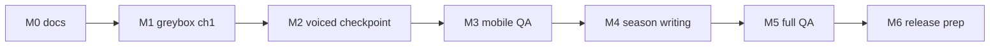

# Effort plan — Angel redesign (Phase 1 + checkpoint)

**Branch:** `cursor/redesign-angel-city-d81d` (docs only this run).  
**First checkpoint (Owner):** **one fully playable, quality-voiced Chapter 1** — if engagement holds, expand Season 1.  
**Out of scope this run:** prototype build, voiced assets, gameplay video, QA sign-off (deliverables 4–6 implementation).

---

## Milestones

| Milestone | Deliverable | Exit criteria |
|-----------|-------------|---------------|
| **M0** | Design pack (this PR) | Audit + GDD + Season1 + CH1 script + Owner questions |
| **M1** | **Playable ch1 greybox** | Angel City arrival → room → cafe → message; no Piper in player-facing path optional |
| **M2** | **Checkpoint: voiced ch1** | Human narrator + Angelina + 1 NPC; subtitles; all M1 beats completable |
| **M3** | Mobile perf pass | Meets GDD budgets on reference devices; human phone kit executed |
| **M4** | Season 1 content lock | Five chapters scripted + data in `quests.json` |
| **M5** | QA + defect burn-down | Owner QA list green |
| **M6** | ICE / YouTube package | After Owner Acceptance Gate — **no public promo before GO** |

---

## Workstreams & effort (engineering order-of-magnitude)

Estimates are **person-weeks of focused dev+design**, not calendar promises. Parallel work reduces wall time.

| Workstream | M1 | M2 | M3 | M4 | Notes |
|------------|----|----|----|----|-------|
| **NarratorDirector + events** | 1.5 | 0.5 | 0.5 | 1 | New module; hook SpeechBridge |
| **Angelina host AI (lead/follow)** | 2 | 1 | 1 | 1 | `world3d` pathing; wait on Q5 |
| **Angel City greybox art** | 2 | 1 | 0.5 | 3 | Reuse location pipeline |
| **Room decorate + clothes MVP** | 1.5 | 0.5 | 0.5 | 1 | Extend build/shop |
| **Cafe shift minigame** | 1 | 0.5 | 0.5 | 0.5 | Pattern from jobs |
| **Dialogue/data** | 1 | 1 | 0 | 2 | Import `CH1_DIALOGUES` |
| **Journal / mission UI** | 1 | 0.5 | 0.5 | 1 | New mission card |
| **Audio beds + mix** | 0.5 | 1 | 0.5 | 1 | Retire rock tracks |
| **Human VO pipeline** | 0 | 2 | 0.5 | 2 | Studio + manifest |
| **Mobile perf** | 0.5 | 0.5 | 2 | 1 | Profiling |
| **Child-safe chat** | 0 | 1 | 0.5 | 1 | Phrase wheel |
| **Save/migrate flags** | 0.5 | 0.5 | 0.5 | 1 | Schema bump |
| **Automated + human QA** | 1 | 1 | 2 | 2 | See QA plan |
| **Roblox alignment** | 0 | 0 | 0 | 1–3 | After Q12 |
| **Total (approx.)** | **~12** | **~10** | **~9** | **~17** | Overlap possible |

---

## Dependencies needing Owner decisions

| Decision | Blocks |
|----------|--------|
| Q1 Setting | All art/narrative |
| Q3 ch0 replacement | M1 onboarding scope |
| Q5 Angelina avatar | Host fidelity in M2 |
| Q8 Voice budget | M2 checkpoint quality |
| Q12 Roblox | M4 quest ids |
| GO on deploy | Any public URL |
| GO on payments | Stripe sandbox beyond docs |

---

## Professional voice — budget options (public rate cards only)

**No vendor connected; no spend authorized.** Ranges for planning:

| Source | Category | Published range | URL |
|--------|----------|-----------------|-----|
| Voice Crafters (GVAA-based guide) | Video game session | **$200–$350/hr**, 2–4 hr min, buyout | https://www.voicecrafters.com/industry-standard-voice-over-rates/ |
| Voice Crafters | Non-broadcast narration | **$350–$450** / 1–2 min (~300 words) | same |
| Chris Butera (GVAA gaming sheet 2025) | Video games | **$300/hr**, 2 hr min | https://www.chrisbuteravoice.com/ (Gaming PDF) |
| Chris Butera | Mobile game characters | **~$400/game** (≤1 hr, few voices) | same |
| Voquent | Game characters ~200–300 words | **from ~$650** (20 lines) | https://www.voquent.com/voice-over/rates/ |
| Real Voice Over calculator | Video games | **~$0.24/word** (150 words ≈ **$108–138** avg) | https://realvoiceover.com/tools/voice-rate-calculator |

**Rough ch1 script sizing (`CH1_DIALOGUES.md`):** ~600–900 spoken words RU → **indie actor buyout** often **$1.5k–4k** if narrator + 2 characters + directed session (scale using word + hourly tables above); **Piper TTS** ≈ **$0** marginal (already in repo) but **fails Owner quality gate**.

---

## 3D quality upgrade (assets & licences)

| Need | Options | Licence notes |
|------|---------|---------------|
| Angelina model | Meshy commission / custom rig | CC BY 4.0 like existing heroes |
| Environment kits | Kenney / Sketchfab CC0 / custom | Track in `docs/audio/LICENSES.md` style manifest |
| Animation pack | UAL / Quaternius | Already `LICENSE-ANIMATIONS.txt` |
| Textures | Poly Haven CC0 | PBR consistency pass |

**Effort:** 2–4 weeks art direction + implementation for ch1-only city block.

---

## Age-group user testing (real people)

| Requirement | Plan |
|-------------|------|
| Participants | 13–15 target; parental consent forms |
| Protocol | `PLAYTEST_NEW_PLAYER_PHONE.md` + 10 min ch1 |
| Ethics | No PII in recordings; store outside git |
| Effort | 1 week recruit + 2 days sessions + report |

**Cannot be done by Cloud Agent.**

---

## Roblox #44 alignment

- Shared: `data/story/quest-table.json`, `QUEST_TABLE.md` ids.  
- **Effort:** 1–3 weeks after Owner Q12 to port Season 1 ids or document fork.

---

## QA plan (Owner mandatory list)

| # | Owner requirement | Method |
|---|-------------------|--------|
| 1 | First goal understood without outside explanation | Human phone kit + observation sheet |
| 2 | Dialogues / voice / subtitles work | M2 build; LQA ru/en/da/uk |
| 3 | All required missions completable | Test matrix per quest id |
| 4 | Rewards credited; progress saved | RTDB emulator + F5 tests |
| 5 | Hints at right moment | Angelina tier telemetry |
| 6 | Graphics / performance on target devices | FPS/memory profile |
| 7 | No critical bugs / empty scenes / blocked transitions | Exploratory + automated smoke |
| 8 | Age-group testing + parental consent | External sessions |

**Automated (supporting, not replacing human):**

- `npm run test:honest-ch01-emulator-e2e` (Tykvograd path — replace with `test:s1-ch1` when built)  
- `npm run test:p1-gameplay-economy`  
- `docs/release/PLAYTEST_NEW_PLAYER_PHONE.md`

---

## Phase 1 deliverable status (this PR)

| Directive # | Item | Status |
|-------------|------|--------|
| 1 | Audit | ✅ `AUDIT_CURRENT_BUILD.md` |
| 2 | GDD | ✅ `GDD.md` |
| 3 | Season + ch1 dialogues | ✅ `SEASON1_SCRIPT.md`, `CH1_DIALOGUES.md` |
| 4 | Prototype 10 min voiced | ❌ not started |
| 5 | Real gameplay video | ❌ not started |
| 6 | QA report + effort | ✅ effort here; QA after build |

---

## Risks

- Canon deadlock (Q1/Q2) delays all art.  
- ICE approval latency on Angelina 3D.  
- Voice budget vs checkpoint date.  
- Two parallel story tracks (Tykvograd code vs Angel script) confuse QA unless gated.
