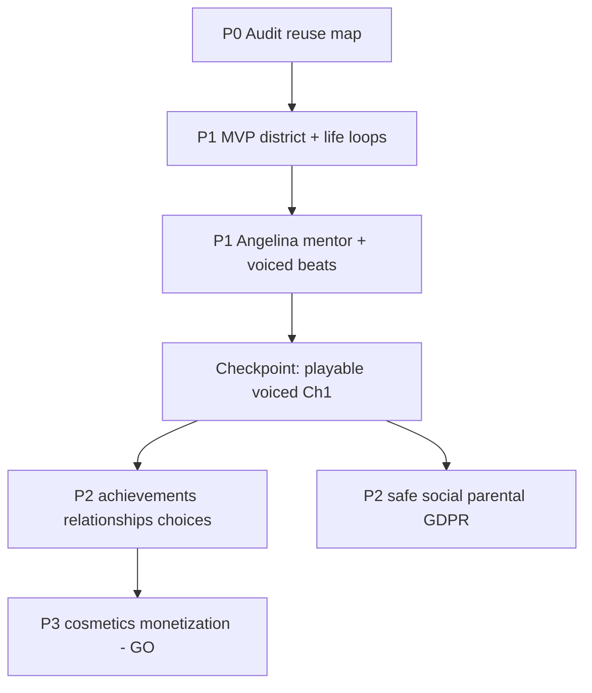

# Effort plan — My Life, My Story (Owner priorities t137u)

**Branch:** `cursor/redesign-angel-city-d81d` (docs); implementation follows Owner decisions.  
**First checkpoint:** **playable vertical slice** (`VERTICAL_SLICE_PLAN.md`) — life ch1 with temp VO, not docs-only.  
**Not claimed:** prototype, video, QA sign-off, any user test sessions.

---

## Priority stack (Owner t137u — do not reorder without GO)

| Phase | Owner label | Scope |
|-------|-------------|--------|
| **P0** | Audit | Keep working mechanics; decide reuse (`AUDIT_CURRENT_BUILD.md`); no destruction of existing game until MVP path clear |
| **P1 MVP** | Game | **One district**, home, **clothes shop**, **cafe**, **3–5 NPCs**, **currency**, **first story missions** |
| **P1** | Angelina mentor | Age **13–15** look; clear hints; dialogues; **voiced key events** (human VO target) |
| **P2** | Progress | Saved **achievements**, unlockables, **NPC relationships**, **story choices** |
| **P2** | Safe social | **Co-op** (instanced), **quick phrases**, **parental settings**, child protection, **GDPR** |
| **P3** | Monetization | **Cosmetics only** — extra decor, seasonal collections; **no** pay-for-story; **no** pressure on kids; **payments require Owner GO** |

---

## Milestones (mapped to priorities)

| Milestone | Priority | Exit criteria |
|-----------|----------|---------------|
| **M0** | P0 | Design pack + audit signed by Owner |
| **M1** | P1 MVP | One district: home, clothes shop, cafe, 3–5 NPCs, currency, ch1 missions completable (greybox VO ok) |
| **M2** | P1 + checkpoint | **Voiced** narrator + Angelina key lines; subtitles; 3–5 min fun path green |
| **M3** | P2 progress | Achievements, relationship save, choice flags persist F5 |
| **M4** | P2 social | Phrase chat/co-op stub + parental toggles + consent docs legal OK |
| **M5** | Season content | Ch2–5 scripted in data |
| **M6** | QA | Owner mandatory QA list + human minors tests (Owner recruits) |
| **M7** | P3 | Cosmetic shop **only** after GO; no story SKUs |

---

## P1 MVP work breakdown (person-weeks, order-of-magnitude)

| Workstream | Weeks | Notes |
|------------|-------|-------|
| Angel City district greybox | 2 | Reuse `locations.mjs` pipeline |
| Home + furniture snap | 1.5 | Extend existing build |
| Clothes shop + outfit mission | 1 | First 3–5 min beat |
| Cafe + work minigame | 1 | Currency loop |
| 3–5 NPCs + dialogues ch1 | 1.5 | `CH1_DIALOGUES.md` |
| Currency + UI монеты | 0.5 | After **D4** |
| Story missions + journal card | 1 | Next achievable goal |
| Angelina mentor (lead/hint/VO hooks) | 2 | Blocked on Q5 avatar |
| NarratorDirector key beats | 1 | No long tutorial |
| Save schema flags | 0.5 | relationships, reputation seed |
| Automated smoke ch1 | 1 | New test id |
| **P1 subtotal** | **~13** | Parallel art/audio reduces wall time |

P2/P3 workstreams: see prior matrix in archive section below (achievements ~2w, social ~3w, parental ~1w, cosmetics ~2w after GO).

---

## Dependencies (Owner decisions)

| ID | Topic |
|----|--------|
| Q1–Q3 | Setting, season vs Bell, ch0 replacement |
| Q14–Q16 | **New** gender/title, punk canon in Angel City, graveyard district (t137u) |
| Q5, Q8 | Angelina 3D + human VO budget |
| Q12 | Roblox |
| GO | Deploy, payments, public marketing |

---

## Professional voice (unchanged references)

Public rate cards only — **no vendor engaged:**

- Voice Crafters / GVAA: game session **$200–350/hr**, 2–4 hr min — https://www.voicecrafters.com/industry-standard-voice-over-rates/  
- Voquent characters ~650+ USD / 20 lines — https://www.voquent.com/voice-over/rates/  
- Real Voice Over ~**$0.24/word** game — https://realvoiceover.com/tools/voice-rate-calculator  

Ch1 script ~600–900 words → plan **$1.5k–4k** human buyout range for narrator + Angelina + 1 NPC (planning only).

---

## QA plan (Owner mandatory + minors)

| # | Requirement | When |
|---|-------------|------|
| 1 | First goal without outside help | Human phone kit |
| 2 | VO/subtitles/dialogues | M2+ |
| 3 | Missions completable | Per quest id |
| 4 | Rewards + save | RTDB tests |
| 5 | Hints timing | Angelina telemetry |
| 6 | Mobile perf | GDD budgets |
| 7 | No blockers | Exploratory |
| 8 | **Minors age tests** | Owner recruits; **DRAFT** consent `docs/release/PARENTAL_CONSENT_PLAYTEST.md` |

**No test performed by agents.**

---

## Phase 1 docs status (Draft PR #50, t138u)

| Deliverable | File | Status |
|-------------|------|--------|
| Audit | `AUDIT_CURRENT_BUILD.md` | ✅ |
| GDD + acceptance | `GDD.md` §15 | ✅ t138u |
| Season map | `SEASON1_SCRIPT.md` | ✅ canon-mapped |
| Ch1 script + ids | `CH1_DIALOGUES.md` | ✅ |
| Owner decisions | `OWNER_DECISIONS.md` | ✅ |
| Keep/improve/replace | `KEEP_IMPROVE_REPLACE.md` | ✅ |
| Voice stages | `VOICE_OPTIONS.md` | ✅ |
| Quality benchmark | `QUALITY_BENCHMARK.md` | ✅ |
| Vertical slice plan | `VERTICAL_SLICE_PLAN.md` | ✅ |
| Owner questions (detail) | `OWNER_QUESTIONS.md` | ✅ |
| Effort | this file | ✅ |

**Checkpoint (implementation):** voiced playable ch1 per `VERTICAL_SLICE_PLAN.md` — **not started** in code.

**Testing order (t138u):** internal QA → minors with **`PARENTAL_CONSENT_PLAYTEST.md`** (r6) — agents run neither child sessions nor claim CEO phone pass.

---

## Risks

- Canon overlap (punk/Halloween vs Angel City) confuses players if Q14–Q16 unresolved.  
- School + Secret Club scope creep before cafe loop proven.  
- P3 monetization before P2 child safety creates compliance risk — **blocked by design**.
