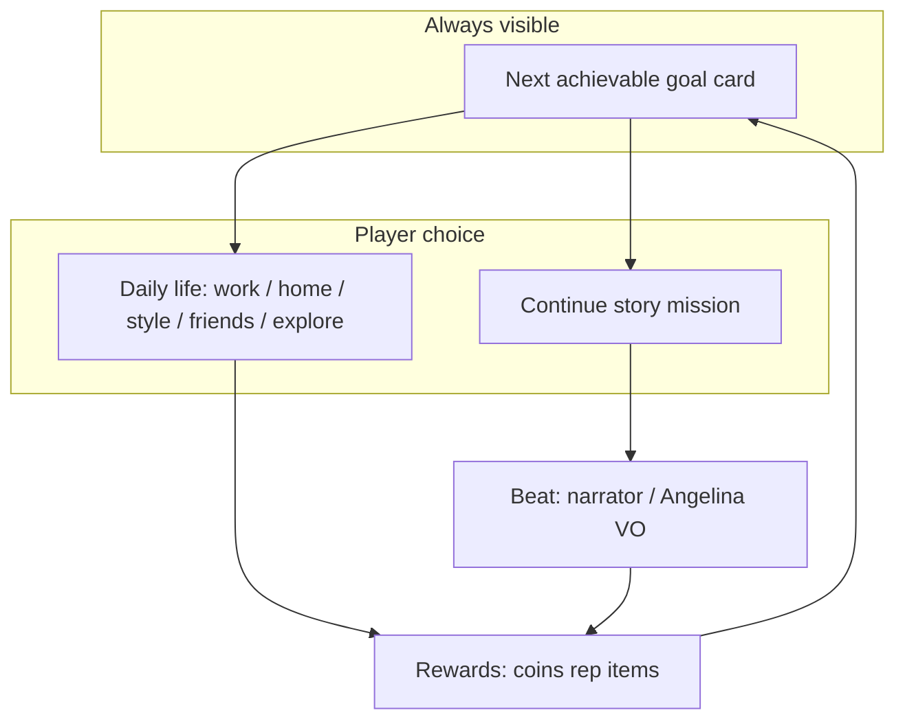
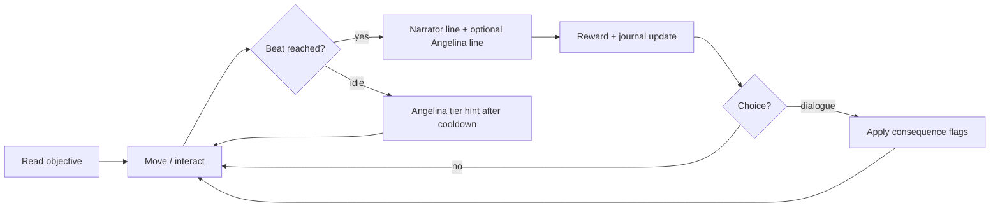

# GDD — PUNK ME ANGEL: My Life, My Story (Phase 1 architecture)

**Working title (Owner t137u):** **PUNK ME ANGEL — My Life, My Story** = **Life Simulator + Mystery Story**. **“Angel City”** = working title only (t138u).  
**Status:** design only (no implementation in this doc pass).  
**Baseline code reuse:** r6 @ `b4ea4c7`.  
**ORIGINAL LOCK (t138u):** Keep approved **story, characters, locations, currency, chapter 0**; concept **develops** the existing game — see [`OWNER_DECISIONS.md`](./OWNER_DECISIONS.md).  
**Owner directives:** t137u concept mapped onto canon; **t138u overrides** where they conflict.

---

## 1. Product pillars

1. **My life, my story** — seven life systems (below) run **every day**; mystery season gives meaning and forward pull.
2. **Next goal, free choice** — UI always shows the **next achievable** story/life goal; player may ignore it for daily life until they choose to continue.
3. **Fun in 3–5 minutes** — no long tutorial wall: **clear mission** → outfit choice → meet Angelina → **first reward** (Owner t137u).
4. **Narrated Gameplay** — narrator at key beats only (cooldowns); reacts to milestones, not continuous chatter.
5. **Angelina mentor** — permanent NPC (13–15 look): hints, dialogues, voiced key events; subtitles + mute.
6. **Choices with consequences** — dialogue flags, relationships, reputation, season branches.
7. **Keep what works** — quest engine, save, 3D locomotion, i18n, reusable assets (`AUDIT_CURRENT_BUILD.md`).

---

## 2. Seven life systems + mystery layer

| System | Player verbs | MVP (P1) | Season growth | Code/data reuse |
|--------|--------------|----------|---------------|-----------------|
| **Home** | Decorate room, place furniture, invite friends over | First room + 3 furniture slots | Room tiers, friend visits | `game.js` build/placement, `room-furniture-catalog.mjs` |
| **Style** | Outfits, mirror, fashion challenges | Clothes shop + ch1 outfit pick | Unlock sets, challenges | char select, shop catalog |
| **School** | Classes, tasks, events | **Stub** in ch2; banner in city | Ch3 Secret Club hub | new `school` district + quests |
| **Work** | Cafe / shop / studio shifts → currency | **Cafe** shift in ch1 | Shop, design studio jobs | `jobs.json`, `gameplay-v21.mjs` |
| **Friends** | Talk, choices, affinity | 3–5 NPCs in district 1 | Schedules, gifts | `dialogues.json`, `story.relationships` |
| **City** | Explore districts, shops, secrets | **One district** + cafe + clothes | Parks, secret locations | `story-spine.mjs` unlocks, `locations.mjs` |
| **Reputation** | Help others, creativity, missions | Hidden numeric + 1 visible rank toast | Achievements surface | extend `story.reputation` (new) |

**Mystery story layer (Season 1):** sits **above** daily life — journal missions, narrator beats, cliffhangers per chapter (`SEASON1_SCRIPT.md`). Player can grind cafe or decorate **outside** the main mission; story gates **districts/secrets**, not basic room decoration.

---

## 3. Core loop (session)

**Dual loop:** (A) **Story mission** from journal; (B) **Daily life** optional anytime.





| Phase | Player | Systems |
|-------|--------|---------|
| Orient | See Mission N, reward preview, marker on Angelina/target | `story-goal-hud`, beacons, host AI state |
| Act | Walk, interact, dialogue | `world3d`, interact priority, dialogue runtime |
| Beat | Trigger `NarratorEvent` | Event bus (new), cooldown table |
| Resolve | Coins/XP/item/unlock | `story-save-schema`, `balance.json` (**монеты** / `me.coins` — LOCK) |
| Persist | Autosave on beat | existing `saveMe()` |

**First life-sim session (3–5 min after ch0):** outfit → meet Angelina → follow → **first монеты reward** — **does not replace** `q_ch0_newbie` (`onboarding.js` **Keep** until **D3** Owner GO).

---

## 4. Narrated Gameplay system

### 3.1 Event model (new layer on top of story-engine)

```json
{
  "id": "narr_arrival_01",
  "trigger": { "type": "quest_step", "quest": "q_s1_ch1_arrival", "step": "cinematic_end" },
  "cooldownGroup": "narrator_main",
  "cooldownSec": 45,
  "priority": 10,
  "lines": [
    { "speaker": "narrator", "voiceId": "narr_arrival_01_ru", "subtitleKey": "narr_arrival_01" }
  ],
  "blockUntil": "line_complete",
  "skipIfFlag": "narr_arrival_01_heard"
}
```

**Rules (Owner):**

- Narrator **never** queues back-to-back without cooldown unless `priority >= critical` (chapter end).
- Gameplay **never** hard-pauses longer than `maxLineSec` (default 12s) except scripted cinematic (2 min cap in ch1 arrival).
- Player movement allowed during subtitle unless `cinematic: true`.

### 3.2 Implementation mapping

| Component | Reuse | Rebuild |
|-----------|-------|---------|
| Subtitle UI `#voiceSubtitle` | **Reuse** | — |
| `SpeechBridge.playLine` | **Reuse** pipeline | Replace audio sources with human VO |
| `narrator.mjs` polling | **Deprecate** for season | Replace with event-driven `NarratorDirector` module |
| `me.dialogueHeard` / flags | **Reuse** | Extend schema |

---

## 5. Angelina — mentor NPC (not just help panel)

### 4.1 Behaviours

| Mode | When | Behaviour |
|------|------|-----------|
| **Lead** | Active mission “follow” | Path toward next beacon; wait if player far; idle emote if stuck |
| **Follow** | Free roam after mission | Trails at 2–3 m, faces player when talking |
| **Comment** | After choice / failure | One short line + tier-1 hint refresh |
| **Hint** | Idle > 60s on step | Escalate tier 1→4 (existing), never spoil future chapter |

### 4.2 Presentation

- **3D avatar:** requirements only until ICE spec approved (see `OWNER_QUESTIONS.md`):
  - Age read 13–15, modest outfit, readable silhouette at mobile scale.
  - Lip-sync hook compatible with `World3D.setTalking`.
  - Distinct from gang Meshy heroes (new GLB or approved Meshy commission).
- **Until model ships:** enhanced 2D portrait + world “ghost guide” marker (interim — Owner must accept or reject).

### 4.3 Code reuse

| Module | Action |
|--------|--------|
| `angelina-help.mjs` | **Reuse** tier + panel; wire to host state |
| `angelina-guide.mjs` | **Reuse** copy selection |
| `authority.mjs` HUD | **Optional** rename/replace for life-sim “Trust” meter (canon conflict) |

---

## 6. Dialogue system (choices & consequences)

### 5.1 Data format (extends `dialogues.json`)

```json
{
  "id": "dlg_cafe_friend_01",
  "start": "n0",
  "nodes": {
    "n0": {
      "speaker": "npc_mira",
      "text": { "ru": "…", "en": "…", "da": "…", "uk": "…" },
      "choices": [
        {
          "label": { "ru": "Улыбнуться и представиться" },
          "next": "n1a",
          "effects": [
            { "setFlag": "rel_mira", "value": "warm" },
            { "addCurrency": 5 },
            { "grantOnce": "ach_first_friend" }
          ]
        }
      ]
    }
  }
}
```

### 5.2 Consequence storage

- **Reuse** `story.flags`, `story.relationships` (extend in `story-save-schema.mjs`).
- **Journal** mirrors active quest + last choice outcomes (human-readable, no raw keys).

### 5.3 Runtime

- **Reuse** `story-engine.mjs` choice renderer + effect executor.
- **Add** validation script in CI: every choice has ≥1 effect or explicit `flavorOnly: true`.

---

## 7. Quest journal & next-action UI

| UI element | Purpose | Reuse |
|------------|---------|-------|
| `#storyGoalBar` | One line objective + progress | **Reuse** |
| `#questBox` / game menu journal | Step list + rewards | **Reuse** |
| 3D beacon | Arrow + ring | **Reuse** `quest-markers.mjs` |
| Mission card (new) | “Mission 1 — Follow Angelina · Reward: 100 монеты” | **New** HUD component |
| Next action verb | “Иди за Ангелиной” / “Нажми E у двери” | Pull from `angelina-guide` + onboarding hint keys |

---

## 8. Rewards, achievements, unlocks

| System | Current | Target |
|--------|---------|--------|
| Currency | `me.coins` (монеты) | **Keep** field; optional UI rename only after **D4** |
| XP / level | `sqrt` level from XP | KEEP; tie to “life milestones” |
| Achievements | none | **New** `story.achievements[]` + toast + journal tab |
| Location unlock | `story-spine.mjs` | KEEP; map Angel City districts |
| Room decoration | partial build/placement `game.js` | **Expand** ch1 loop (place 3 items → reward) |
| Clothes | shop + character select | **Expand** first-room outfit choice with preview |

---

## 9. Audio design

| Channel | Policy |
|---------|--------|
| **Ambient music** | Per-district stems; **no** thrash rock in cafe/home; licensed or commissioned mellow/neutral beds |
| **Speech** | Human narrator + Angelina + NPC; Piper **dev-only** |
| **SFX** | Keep CC0 UI SFX; add life-sim foley (cup, cloth, door) |
| **Mix** | Duck music −12 dB on VO; separate sliders (already in audio settings) |

**Remove/replace:** Matthew Steele rock pack for life-sim districts (`LICENSES.md` list) — see audit.

---

## 10. Child safety, social (P2), & personal data

| Requirement | Design |
|-------------|--------|
| Age 13+ | Splash + parent copy; no open social profile fields |
| Chat | **Quick phrases only** (preset list); disable free text in Angel City mode |
| PII | No real names in saves; display names from preset list |
| Parental consent | Required for minors user tests — `docs/release/PARENTAL_CONSENT_PLAYTEST.md` (DRAFT) |
| Parental settings (P2) | Toggle chat/co-op, spend caps, session reminders |
| Safe co-op (P2) | Instanced districts; quick phrases only |
| Data | Firebase rules: own `players/{uid}` only; GDPR copy legal review |

**P3 monetization (Owner):** cosmetics, extra decor, seasonal collections only — **no** pay-for-story, **no** pressure on children; payments require separate Owner GO.

**Reuse:** rules pattern in `database.rules.json`; replace chat write shape.

---

## 11. Target devices & performance budget

| Target | Spec |
|--------|------|
| Phone | 390×844 portrait primary; 720p class Android + iPhone 12+ |
| Frame budget | **30 FPS** sustained in hub; **≥24 FPS** in cafe scene |
| Load | First interactive **< 8 s** on 4G (stretch 12 s); progress bar honest |
| Memory | **< 512 MB** JS heap on mobile Safari (measure with WebKit timeline) |
| Assets | GLB hero ≤ 8 MB each; texture atlases BC/ETC2 where supported |

**Reuse:** `mobileQuality` path in `world3d.mjs`; add telemetry hook (future).

---

## 12. Module reuse vs rebuild matrix

| Area | Reuse | Extend | Rebuild |
|------|-------|--------|---------|
| `world3d.mjs` | ✓ locomotion, portals | host NPC follow | Angel City geometry |
| `story-engine.mjs` | ✓ quests/dialogues | narrator events | — |
| `onboarding.js` | step machine | life quest hints after ch0 | **Keep** ch0 content (LOCK) |
| `chapter-intro.mjs` | slide UI | cinematic flag | arrival cinematic |
| `speech-bridge.mjs` | ✓ | human asset paths | — |
| `audio-manager.mjs` | ✓ channels | new music beds | rock tracks retired |
| `angelina-*` | ✓ tiers | host AI | 3D avatar |
| `i18n.js` | ✓ | uk completeness | — |
| `game.js` economy | ✓ | Reward UX (монеты) | — |
| Chat | — | — | phrase picker |
| Achievements | — | — | new module |

---

## 13. Canon relationship

This GDD **extends** the approved Tykvograd product (House 13, ch0, Bell, three endings). Life-sim + mystery layers sit **on top** after Owner resolves [`OWNER_DECISIONS.md`](./OWNER_DECISIONS.md). **Do not** replace `QUEST_TABLE.md` main line without GO.

---

## 14. Deliverables trace (t138u)

| # | Deliverable | File |
|---|-------------|------|
| 1 | Audit | `AUDIT_CURRENT_BUILD.md` |
| 2 | GDD + acceptance matrix | this file §15 |
| 3 | Season map (not replacement) | `SEASON1_SCRIPT.md` |
| 4 | Ch1 script + trigger ids | `CH1_DIALOGUES.md` |
| 5 | Keep / improve / replace | `KEEP_IMPROVE_REPLACE.md` |
| 6 | Owner decisions | `OWNER_DECISIONS.md` |
| 7 | Voice stages | `VOICE_OPTIONS.md` |
| 8 | Quality benchmark | `QUALITY_BENCHMARK.md` |
| 9 | Vertical slice plan | `VERTICAL_SLICE_PLAN.md` |
| 10 | Effort | `EFFORT_PLAN.md` |

**Checkpoint:** playable ch1 slice per `VERTICAL_SLICE_PLAN.md` — not this doc PR alone.

---

## 15. Requirements matrix — implementation + measurable acceptance

Each row must pass **internal QA on agreed target devices** (§11) before vertical slice sign-off.

| GDD element | Technical implementation | Measurable acceptance |
|-------------|-------------------------|------------------------|
| **Seven life systems** | Extend `quests.json` + district flags; reuse shop/jobs/build (`game.js`, `gameplay-v21.mjs`) | P1 slice implements **home, style, work (cafe), friends, city (1 district)**; school/reputation stubs documented; player completes **≥ 1** verb per system in ch1 life quest |
| **Dual loop (story + daily)** | `#storyGoalBar` + mission card reads active `q_life_*` step | **≥ 1** visible “next goal” line at all times during life quest; player can idle **60 s** without crash; optional explore does not block save |
| **3–5 min fun** | Step order: outfit → Angelina → reward within `q_life_ch1_settle` | Internal QA median **≤ 5 min** from life quest start to first **монеты** reward (n≥3 runs) |
| **Narrated Gameplay** | New `NarratorDirector` + `data/story/narrator-events.json`; triggers from quest steps / interact | **≥ 5** distinct `narr_ch1_*` events fire once each per playthrough; cooldown **≥ 40 s** between non-critical lines; `skipIfFlag` prevents repeats |
| **Angelina mentor** | Extend `angelina-help.mjs` / host lead mode; portrait until ICE | Lead mode: player reaches beacons **without** tier-4 hint in **≥ 80%** of internal QA runs; **≥ 3** Angelina spoken lines in ch1 with subtitles |
| **Dialogues + choices** | `dialogues.json` trees; `story-engine.mjs` effects | **≥ 3** dialogues with **≥ 2** choices each; all choices apply flag or `flavorOnly: true` validated in CI |
| **Choice consequences** | `story.flags` / `story.lifeFlags` | **≥ 1** flag set in ch1 changes dialogue or journal text later in same quest (e.g. `mystery_open` → Mira line variant) |
| **Navigation / goals unaided** | Beacons `quest-markers.mjs`, one verb hints | Internal QA: **100%** testers reach each step goal **without** console/cheats; **0** soft-lock **> 3 min** on a step |
| **Progress persist** | `saveMe()` on beat; Firebase `players/{uid}` | Exit tab + re-open within 24 h restores step, flags, **монеты** total ± last reward; automated test asserts field equality |
| **Voice + subtitles** | `speech-bridge.mjs`, `#voiceSubtitle`, Stage 1 TTS mp3 | Every ch1 `voiceId` plays; subtitle visible within **500 ms** of audio start; mute setting silences VO but keeps subtitles |
| **Currency** | `me.coins`, grant keys on steps | Rewards match script totals ±0; UI shows **монеты** unless **D4-A** approved |
| **Chapter 0 (LOCK)** | `onboarding.js`, `q_ch0_newbie` | Regression: ch0 completable to `reward_ch0_complete` with **no** life quest forced mid-flow |
| **Quest journal** | `#questBox`, journal entry on mystery | Journal lists life quest steps; completion writes human-readable entry «Первое послание» |
| **Cafe work** | Minigame hook 3 orders | **≥ 1** successful order grants coins; fail allows retry with tier-2 hint only |
| **Home decorate** | 3 snap slots | Place bed/desk/lamp → step complete flag; **≥ 3** placements required |
| **Style outfit** | Mirror / kiosk 3 presets | One outfit flag set; mirror skippable if kiosk done |
| **Audio mix** | `audio-manager.mjs` duck | VO active → music reduced measurable in QA checklist (see `QUALITY_BENCHMARK.md`) |
| **Mobile perf** | `mobileQuality`, touch controls | **≥ 30 FPS** home, **≥ 24 FPS** cafe (10 s sample) on target phones |
| **Child safety (P2 design)** | Phrase chat spec, parental toggles | Not required for slice pass; documented in §10 |
| **Monetization (P3)** | None in slice | **0** payment UI in vertical slice build |
| **Testing process** | CI smoke + internal QA | Automated **`test:life-ch1-smoke`** green; then human phone QA; minors only after consent (**D18**) |
