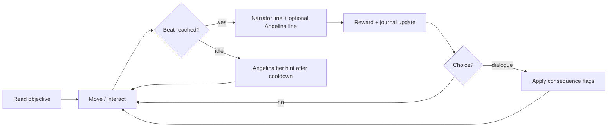

# GDD — PUNK ME ANGEL: Interactive Life Story Simulator (Phase 1 architecture)

**Status:** design only (no implementation in Phase 1 doc pass).  
**Baseline code reuse:** r6 @ `b4ea4c7`.  
**Owner directive:** t135u (2026-10-30) — Narrated Gameplay, Angelina host, Season 1 × 5 chapters, child-safe life-sim layer.

---

## 1. Product pillars

1. **Life story first** — clear chapter arc (goal → conflict → climax → resolution → cliffhanger) each session.
2. **Narrated Gameplay** — narrator speaks at **story beats**, not continuously; reacts to player milestones.
3. **Angelina as host** — always available NPC guide (13–15 look): follow/lead, short hints, emotional support; subtitles + mute.
4. **Player agency** — dialogue choices with **persisted consequences** (flags, relationships, unlocks).
5. **Readable next action** — journal + world markers + one primary objective line.
6. **Keep what works** — 3D locomotion, quest engine, Firebase save, i18n, existing hero assets where canon allows.

---

## 2. Core loop (session)



| Phase | Player | Systems |
|-------|--------|---------|
| Orient | See Mission N, reward preview, marker on Angelina/target | `story-goal-hud`, beacons, host AI state |
| Act | Walk, interact, dialogue | `world3d`, interact priority, dialogue runtime |
| Beat | Trigger `NarratorEvent` | Event bus (new), cooldown table |
| Resolve | Coins/XP/item/unlock | `story-save-schema`, `balance.json` (Angel Coins rename TBD — see OWNER_QUESTIONS) |
| Persist | Autosave on beat | existing `saveMe()` |

---

## 3. Narrated Gameplay system

### 3.1 Event model (new layer on top of story-engine)

```json
{
  "id": "narr_arrival_01",
  "trigger": { "type": "quest_step", "quest": "q_s1_ch1_arrival", "step": "cinematic_end" },
  "cooldownGroup": "narrator_main",
  "cooldownSec": 45,
  "priority": 10,
  "lines": [
    { "speaker": "narrator", "voiceId": "narr_arrival_01_ru", "subtitleKey": "narr_arrival_01" }
  ],
  "blockUntil": "line_complete",
  "skipIfFlag": "narr_arrival_01_heard"
}
```

**Rules (Owner):**

- Narrator **never** queues back-to-back without cooldown unless `priority >= critical` (chapter end).
- Gameplay **never** hard-pauses longer than `maxLineSec` (default 12s) except scripted cinematic (2 min cap in ch1 arrival).
- Player movement allowed during subtitle unless `cinematic: true`.

### 3.2 Implementation mapping

| Component | Reuse | Rebuild |
|-----------|-------|---------|
| Subtitle UI `#voiceSubtitle` | **Reuse** | — |
| `SpeechBridge.playLine` | **Reuse** pipeline | Replace audio sources with human VO |
| `narrator.mjs` polling | **Deprecate** for season | Replace with event-driven `NarratorDirector` module |
| `me.dialogueHeard` / flags | **Reuse** | Extend schema |

---

## 4. Angelina — permanent NPC host

### 4.1 Behaviours

| Mode | When | Behaviour |
|------|------|-----------|
| **Lead** | Active mission “follow” | Path toward next beacon; wait if player far; idle emote if stuck |
| **Follow** | Free roam after mission | Trails at 2–3 m, faces player when talking |
| **Comment** | After choice / failure | One short line + tier-1 hint refresh |
| **Hint** | Idle > 60s on step | Escalate tier 1→4 (existing), never spoil future chapter |

### 4.2 Presentation

- **3D avatar:** requirements only until ICE spec approved (see `OWNER_QUESTIONS.md`):
  - Age read 13–15, modest outfit, readable silhouette at mobile scale.
  - Lip-sync hook compatible with `World3D.setTalking`.
  - Distinct from gang Meshy heroes (new GLB or approved Meshy commission).
- **Until model ships:** enhanced 2D portrait + world “ghost guide” marker (interim — Owner must accept or reject).

### 4.3 Code reuse

| Module | Action |
|--------|--------|
| `angelina-help.mjs` | **Reuse** tier + panel; wire to host state |
| `angelina-guide.mjs` | **Reuse** copy selection |
| `authority.mjs` HUD | **Optional** rename/replace for life-sim “Trust” meter (canon conflict) |

---

## 5. Dialogue system (choices & consequences)

### 5.1 Data format (extends `dialogues.json`)

```json
{
  "id": "dlg_cafe_friend_01",
  "start": "n0",
  "nodes": {
    "n0": {
      "speaker": "npc_mira",
      "text": { "ru": "…", "en": "…", "da": "…", "uk": "…" },
      "choices": [
        {
          "label": { "ru": "Улыбнуться и представиться" },
          "next": "n1a",
          "effects": [
            { "setFlag": "rel_mira", "value": "warm" },
            { "addCurrency": 5 },
            { "grantOnce": "ach_first_friend" }
          ]
        }
      ]
    }
  }
}
```

### 5.2 Consequence storage

- **Reuse** `story.flags`, `story.relationships` (extend in `story-save-schema.mjs`).
- **Journal** mirrors active quest + last choice outcomes (human-readable, no raw keys).

### 5.3 Runtime

- **Reuse** `story-engine.mjs` choice renderer + effect executor.
- **Add** validation script in CI: every choice has ≥1 effect or explicit `flavorOnly: true`.

---

## 6. Quest journal & next-action UI

| UI element | Purpose | Reuse |
|------------|---------|-------|
| `#storyGoalBar` | One line objective + progress | **Reuse** |
| `#questBox` / game menu journal | Step list + rewards | **Reuse** |
| 3D beacon | Arrow + ring | **Reuse** `quest-markers.mjs` |
| Mission card (new) | “Mission 1 — Follow Angelina · Reward: 100 Angel Coins” | **New** HUD component |
| Next action verb | “Иди за Ангелиной” / “Нажми E у двери” | Pull from `angelina-guide` + onboarding hint keys |

---

## 7. Rewards, achievements, unlocks

| System | Current | Target |
|--------|---------|--------|
| Currency | `me.coins` (монеты) | **Angel Coins** cosmetic rename + icon (Owner) |
| XP / level | `sqrt` level from XP | KEEP; tie to “life milestones” |
| Achievements | none | **New** `story.achievements[]` + toast + journal tab |
| Location unlock | `story-spine.mjs` | KEEP; map Angel City districts |
| Room decoration | partial build/placement `game.js` | **Expand** ch1 loop (place 3 items → reward) |
| Clothes | shop + character select | **Expand** first-room outfit choice with preview |

---

## 8. Life-sim systems (Season 1 scope)

| Pillar | MVP (ch1) | Season arc |
|--------|-----------|------------|
| **Home / room** | Pick room, place furniture, outfit mirror | Upgrade room tier |
| **Friends** | 1 NPC friend + affinity flag | Small cast with schedules |
| **Work** | Cafe mini-shift (timed prompts) | City jobs from `jobs.json` pattern |
| **City** | Angel City hub + cafe interior | Unlock districts by chapter |
| **Currency** | Earn/spend Angel Coins | Balance from `balance.json` |
| **Progress** | Chapter flags + journal | Five-chapter season gate |

**Reuse:** `gameplay-v21.mjs` job pattern, `goLocation`, shop catalog in `game.js`.

---

## 9. Audio design

| Channel | Policy |
|---------|--------|
| **Ambient music** | Per-district stems; **no** thrash rock in cafe/home; licensed or commissioned mellow/neutral beds |
| **Speech** | Human narrator + Angelina + NPC; Piper **dev-only** |
| **SFX** | Keep CC0 UI SFX; add life-sim foley (cup, cloth, door) |
| **Mix** | Duck music −12 dB on VO; separate sliders (already in audio settings) |

**Remove/replace:** Matthew Steele rock pack for life-sim districts (`LICENSES.md` list) — see audit.

---

## 10. Child safety & personal data

| Requirement | Design |
|-------------|--------|
| Age 13+ | Splash + parent copy; no open social profile fields |
| Chat | **Quick phrases only** (preset list); disable free text in Angel City mode |
| PII | No real names in saves; display names from preset list |
| Parental consent | Required for moderated user tests (process in EFFORT_PLAN) |
| Data | Firebase rules: own `players/{uid}` only; COPPA/GDPR copy in `privacy.html` update (legal review) |

**Reuse:** rules pattern in `database.rules.json`; replace chat write shape.

---

## 11. Target devices & performance budget

| Target | Spec |
|--------|------|
| Phone | 390×844 portrait primary; 720p class Android + iPhone 12+ |
| Frame budget | **30 FPS** sustained in hub; **≥24 FPS** in cafe scene |
| Load | First interactive **< 8 s** on 4G (stretch 12 s); progress bar honest |
| Memory | **< 512 MB** JS heap on mobile Safari (measure with WebKit timeline) |
| Assets | GLB hero ≤ 8 MB each; texture atlases BC/ETC2 where supported |

**Reuse:** `mobileQuality` path in `world3d.mjs`; add telemetry hook (future).

---

## 12. Module reuse vs rebuild matrix

| Area | Reuse | Extend | Rebuild |
|------|-------|--------|---------|
| `world3d.mjs` | ✓ locomotion, portals | host NPC follow | Angel City geometry |
| `story-engine.mjs` | ✓ quests/dialogues | narrator events | — |
| `onboarding.js` | step machine | — | ch1 content → Angel City |
| `chapter-intro.mjs` | slide UI | cinematic flag | arrival cinematic |
| `speech-bridge.mjs` | ✓ | human asset paths | — |
| `audio-manager.mjs` | ✓ channels | new music beds | rock tracks retired |
| `angelina-*` | ✓ tiers | host AI | 3D avatar |
| `i18n.js` | ✓ | uk completeness | — |
| `game.js` economy | ✓ | Angel Coins UI | — |
| Chat | — | — | phrase picker |
| Achievements | — | — | new module |

---

## 13. Canon relationship

This GDD describes **Owner’s new product direction**. Existing Tykvograd canon (House 13, Bell, three endings) remains documented in `STORY_ENDINGS_TZ_2026-10-25.md` and `QUEST_TABLE.md`. **Do not merge timelines without Owner decision** — see `OWNER_QUESTIONS.md`.

---

## 14. Deliverables trace (directive Phase 1)

| # | Deliverable | This doc set |
|---|-------------|--------------|
| 1 | Audit | `AUDIT_CURRENT_BUILD.md` |
| 2 | GDD | this file |
| 3 | Season script + ch1 dialogues | `SEASON1_SCRIPT.md`, `CH1_DIALOGUES.md` |
| 6 (partial) | Effort plan | `EFFORT_PLAN.md` |

Items 4–5 (voiced prototype, gameplay video) are **implementation Phase 2+**, not claimed here.
