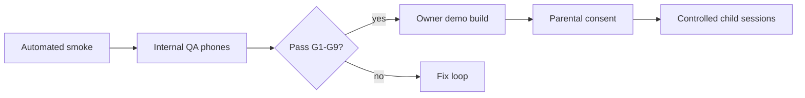

# Chapter 1 playable vertical slice — implementation plan

**Checkpoint (t138u):** A **short complete fragment** of real gameplay — narrator, Angelina hints, dialogues, tasks, rewards, **persisted save** — at target quality. **Documents alone do not complete the redesign.**

**Canon gate:** Implement **after** Owner confirms **D3** (ch0 keep) and **D2/B** (life quest after ch0). Proposed quest id: **`q_life_ch1_settle`** (working name).

**Baseline branch for code:** fork from r6 / redesign implementation branch — **not** part of this doc-only commit.

---

## Scope IN / OUT

| IN (slice) | OUT (later) |
|------------|-------------|
| Life ch1 beats from `CH1_DIALOGUES.md` with **exact narrator ids** | Full Season 1 ch2–5 playable |
| ≥ **5** narrator events, ≥ **3** choice dialogues, ≥ **1** delayed consequence | School, Secret Club district |
| **`me.coins`** rewards, autosave on beats | Angel Coins rebrand, payments |
| Stage **1** temp commercial TTS (`VOICE_OPTIONS.md`) | Final human VO (Stage 2) |
| Angelina **portrait + lead/beacon** (no ICE model) | 3D Angelina avatar |
| Cafe shift minigame (3 orders) | Co-op, phrase chat |
| Internal QA on target phones | Minors playtest (after QA + consent) |

---

## Task breakdown (order)

| # | Task | Effort (dev-days) | Depends | Deliverable |
|---|------|-------------------|---------|-------------|
| 1 | Owner signs **D3/D4/D7** in PR | 0 | — | Comment on `OWNER_DECISIONS.md` |
| 2 | Data: `q_life_ch1_settle` steps + flags in `quests.json` | 2 | 1 | Quest reachable after `onboarding.done` |
| 3 | `NarratorDirector` module + `data/story/narrator-events.json` | 3 | 2 | 5+ events fire with cooldown |
| 4 | Wire `CH1_DIALOGUES` lines → voice-lines + i18n | 2 | 3 | No 404 VO |
| 5 | Stage 1 TTS generation script (paid API, keys in CI secret) | 2 | 4 | Temp mp3 in `assets/audio/voice/` |
| 6 | Mission card UI (“next goal + reward”) | 2 | 2 | Single objective visible |
| 7 | Angelina lead mode + tier hints on life steps | 3 | 2,6 | Follow beacon works mobile |
| 8 | Room outfit + 3 furniture snaps (reuse build) | 3 | 2 | Flags `outfit_*`, decorate step |
| 9 | `dlg_s1_mira_intro` + consequence flags | 2 | 2 | 3 choices, 1 affects ch2 hook |
| 10 | Cafe shift minigame hook | 3 | 9 | +монеты reward |
| 11 | Mystery note + choice → `mystery_*` flags | 1 | 10 | Consequence persists |
| 12 | Save schema: `story.relationships`, `story.lifeFlags` | 1 | 11 | F5 / re-login restores |
| 13 | Music duck / mute life quest zones | 1 | 2 | **D11** interim |
| 14 | Automated test `test:life-ch1-smoke` | 2 | 12 | CI green |
| 15 | **Internal QA** — phone kit + benchmark | 2 | 5–14 | Signed checklist |
| 16 | Controlled child tests | ext | 15 + consent doc | Owner-run |

**Total engineering (order-of-magnitude):** **~28 dev-days** serial; **~15–18** with parallel art/audio.

---

## Acceptance gate (must all pass for “slice done”)

| # | Criterion | Source |
|---|-----------|--------|
| G1 | Narrator reacts to **≥ 5** defined events (`narr_ch1_*`) | t138u |
| G2 | **≥ 3** interactive dialogues with choice (Mira + 2 Angelina prompts) | t138u |
| G3 | **≥ 1** choice changes a later line or flag (`mystery_*` → Mira distrust hook) | t138u |
| G4 | Player finds every goal **unaided** (internal QA, no dev console) | t138u |
| G5 | Progress persists after exit + re-entry (Firebase save) | t138u |
| G6 | Voice synced with events + subtitles (≤ 500 ms) | t138u, `QUALITY_BENCHMARK.md` |
| G7 | FPS + UI rubric on **agreed phones** | `QUALITY_BENCHMARK.md` |
| G8 | **Chapter 0 still completable** unchanged (regression smoke) | ORIGINAL LOCK |
| G9 | No live payments, no new ICE avatar | t138u |

---

## QA sequence (t138u)

- **Internal QA first** — phone checklist adapted for life-quest path (same bar as release playtest kits when published).
- **Minors:** only after Owner **parental consent** process; agent does not run child tests.

---

## Risk register

| Risk | Mitigation |
|------|------------|
| Dual onboarding confuses players | Single journal tab “Life” gated after ch0 (**D3-C**) |
| VO API cost overrun | Cap regenerations; Stage 1 line lock after QA pass |
| honest e2e flakiness | Dedicated `test:life-ch1-smoke` with stable selectors |
| Canon regression | Mandatory `test:newcomer-no-force` + ch0 completion in CI |

---

## Definition of done (redesign checkpoint)

**Done = playable build** (preview host) where an internal tester completes **`q_life_ch1_settle`** with VO, subtitles, rewards, save — **not** Draft PR docs alone.
