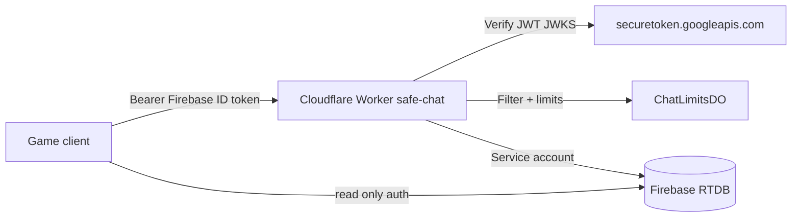

# Safe gang chat — implementation report (DRAFT PR)

## Architecture



- **Worker** (`workers/safe-chat/`): `POST /api/chat/send`, `POST /api/chat/report`, `GET /api/chat/config`, mod routes under `/api/mod/*`.
- **RTDB**: `chat/messages` read if `auth != null`; **all client writes denied**. Reports/mod/internal paths denied to clients.
- **Client** (`js/safe-chat.js`): reads `chat/messages`, sends via Worker when `window.__PUNK_SAFE_CHAT_URL` is set.

### Compatibility with PR #45

PR #45 adds `MINIMAL_CHAT_FOR_CLIENT` (auth read + client push on `chat/$msgId`). This PR **replaces** the `chat` subtree with `chat/messages` + server-only writes. See `scripts/lib/rtdb-safe-chat-patch.mjs`.

Presence / players rules from PR #45 are **not modified** except optional fields `chatBlocklist`, `chatRegisteredAt` on `players/$uid`.

### Test-only auth (`SAFE_CHAT_TEST_MODE`)

Integration tests set `SAFE_CHAT_TEST_MODE=true` **only** in `vitest.config.js` miniflare bindings (never in `wrangler.toml`). In that mode the Worker validates **real Auth emulator ID tokens** via `accounts:lookup` (not `SAFE_CHAT_SKIP_AUTH`). Guarded by `scripts/test-safe-chat-prod-config.mjs` + `src/prod-config.test.js`.

## Free tier choices (Cloudflare)

Docs (Oct 2026): [Workers pricing/limits](https://developers.cloudflare.com/workers/platform/pricing/), [Durable Objects pricing](https://developers.cloudflare.com/durable-objects/platform/pricing/).

| Resource | Free limit (account/day unless noted) | Our usage pattern | Headroom |
|----------|----------------------------------------|-------------------|----------|
| **Worker HTTP requests** | 100,000 / day (shared with Pages Functions, etc.) | 1 request per send/report/mod action + 1 DO RPC per send; cron 1×/day | Teen gang chat at ~1 msg/3s/player stays far below 100k unless tens of thousands of unique active senders/day |
| **Worker CPU** | 10 ms CPU per invocation | JWT verify + filter + 1× `fetch` to RTDB per send | Light; watch pathological payloads |
| **Durable Objects (SQLite)** | **Only** `new_sqlite_classes` on Free ([changelog](https://developers.cloudflare.com/changelog/post/2026-07-09-restrict-new-kv-backed-namespaces/)) | `ChatLimitsDO` via `new_sqlite_classes`; KV API `storage.get/put` on one global object | Migration guarded in `test-safe-chat-prod-config.mjs` |
| **DO requests** | 100,000 / day | ~1 DO request per successful chat send (rate check) | Same order as Worker sends |
| **DO duration** | 13,000 GB-s / day | Single hibernating object; short `fetch` handler | Tiny vs limit (128 MB × seconds) |
| **DO SQLite rows written** | 100,000 / day | ~2 KV ops per send (get+put limits map) | ~50k sends/day theoretical max on writes alone; product cap 80 msgs/player/day reduces risk |
| **DO SQLite rows read** | 5 million / day | 1 read per send | Comfortable |
| **DO stored data** | 5 GB total | One JSON blob of per-uid counters | Minimal |
| **Cron Triggers** | 5 per account; 1 cron/Worker | Daily retention `0 4 * * *` | OK |
| **Workers KV** | Not used for rate limits | — | Free KV writes (1k/day) insufficient for per-message counters |

**PUNK ME volume (13+, small/medium band):** With default `SAFE_CHAT_DAILY_LIMIT=80` and 3s cooldown, a few hundred concurrent players might generate low thousands of Worker+DO requests per day — well under 100k. Spike risk is shared Worker quota (also used if other Workers exist on the same account).

No Firebase Blaze, no paid moderation APIs.

## Secrets (owner sets at GO — **not done in this PR**)

```bash
cd workers/safe-chat
wrangler secret put FIREBASE_SERVICE_ACCOUNT_JSON
wrangler secret put MODERATOR_UIDS
```

## Run automated tests (no prod)

```bash
npm run test:safe-chat
```

This runs: filter unit tests → RTDB rules on Firebase emulators → wrangler/miniflare vitest (smoke + integration + newbie suite).

## Test matrix (honest)

| Case | Harness | Result |
|------|---------|--------|
| Filter: homoglyphs, spaces, dots, leetspeak | `scripts/safe-chat-filter.test.js` | **PASS** (auto) |
| Filter: obfuscated links, phones, email, RU/UK/DA contact & profanity | same | **PASS** (auto) |
| Filter: length > 200 | same | **PASS** (auto) |
| RTDB: client cannot POST `chat/messages` / legacy `chat/` | `scripts/test-safe-chat-rules.js` + Auth+DB emulator | **PASS** (auto) |
| RTDB: client cannot POST `chat/reports`, PUT `modState/mute`, PUT `internal` | same | **PASS** (auto) |
| RTDB: auth read `chat/messages`; `chatBlocklist` self-write | same | **PASS** (auto) |
| `wrangler.toml` has no `SAFE_CHAT_TEST_MODE` / `SKIP_AUTH` false | `scripts/test-safe-chat-prod-config.mjs` | **PASS** (auto) |
| `wrangler.toml` uses `new_sqlite_classes`, not `new_classes` | same | **PASS** (auto) |
| `wrangler deploy --dry-run` packages Worker + SQLite DO migration | local CLI (no publish) | **PASS** (auto, see CI log in PR) |
| Worker `/api/chat/config` smoke | vitest miniflare | **PASS** (auto) |
| `freeTextEnabled=false` rejects free text, allows phrase | `integration.emulator.test.js` + emulators | **PASS** (auto) |
| Cooldown 3s / daily limit (DO) | integration + miniflare DO | **PASS** (auto) |
| Reports ×3 → auto-hide | integration + emulators | **PASS** (auto) |
| Mute / ban block send | integration | **PASS** (auto) |
| `/api/mod/*` forbidden for non-mod (same API as `moderation.html`) | integration | **PASS** (auto) |
| Mod list reports + delete message | integration | **PASS** (auto) |
| Client blocklist logic | integration (`isBlocked`) + rules blocklist write | **PASS** (auto) |
| Retention 7d / 90d with `SAFE_CHAT_TEST_NOW_MS` | `runRetentionJob` integration | **PASS** (auto) |
| Newbie 10 min phrases-only (`freeTextEnabled=true` in newbie suite only) | `integration.newbie.test.js` | **PASS** (auto) |
| Auth via emulator tokens (not skipAuth) in integration | integration | **PASS** (auto) |
| Live Google JWKS + production Firebase ID tokens | production | **Manual** (owner staging) |
| Full game UI in browser (GitHub Pages + Worker URL) | browser | **Manual** |
| Cron trigger in deployed Worker | Cloudflare dashboard | **Manual** (after GO) |
| Report webhook notification | optional secret | **Manual** (not wired) |
| Legal copy review | owner | **Manual** (Inna) |

## Remaining risks

- Open-source wordlist is not complete; evasion possible → reports + mod tools.
- Single global DO: acceptable at free tier scale.
- Legacy `chat/*` messages not migrated automatically.
- `moderation.html` UI layout/accessibility not browser-tested in CI.

## Owner GO checklist (do **not** execute in this PR)

1. Merge PR #45 (or deploy its rules) if not already live.
2. Merge this PR after review; deploy Worker (`wrangler deploy`).
3. Set secrets (`FIREBASE_SERVICE_ACCOUNT_JSON`, `MODERATOR_UIDS`).
4. Deploy `database.rules.json` from this branch (after backup export).
5. Set `window.__PUNK_SAFE_CHAT_URL` on hosting.
6. Legal review of `docs/legal/CHAT_RULES.md` and `CHAT_PRIVACY.md`.
7. Optionally enable `SAFE_CHAT_FREE_TEXT=true`.
8. Optional: webhook for new reports.
