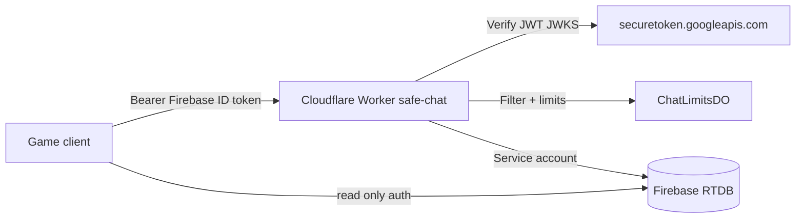

# Safe gang chat — implementation report (DRAFT PR)

## Architecture



- **Worker** (`workers/safe-chat/`): `POST /api/chat/send`, `POST /api/chat/report`, `GET /api/chat/config`, mod routes under `/api/mod/*`.
- **RTDB:** `chat/messages` read if `auth != null`; **writes only via Worker** (service account). **`database.rules.json` in this PR** matches `applySafeChatPatch` (see `scripts/build-safe-chat-rules.mjs` for live-export refresh).

### RTDB rules (in PR diff)

Repo `database.rules.json` includes the safe-chat overlay. For production publish after merge:

```bash
node scripts/build-safe-chat-rules.mjs --write path/to/live-exported-database.rules.json   # owner review only
```

**`npm run test:safe-chat`** runs Firebase emulators against **repo** `database.rules.json` (`scripts/lib/safe-chat-emulator.mjs`).

### Integration auth (not in production bundle)

Production Worker imports `auth-prod.js` (JWKS only). Vitest aliases `auth-prod.js` → `auth.integration.js` (Auth emulator lookup when `SAFE_CHAT_INTEGRATION=1`). Guarded by `scripts/test-safe-chat-prod-source.mjs` + `test-safe-chat-prod-config.mjs` (no `SAFE_CHAT_SKIP_AUTH` / `SAFE_CHAT_TEST_MODE` in `wrangler.toml`).

## Security Governor review (30.10.2026) — remediation

**Reviewed baseline:** `fc9a88d` (FAIL). **This branch head:** see git; re-run review after merge.

| Finding | Sev | Fix | Commit | Test |
|---------|-----|-----|--------|------|
| HIGH-1 Free text via `name`/`loc`; impersonation | HIGH | Profile `name`/`loc` from RTDB; phrase-only when `FREE_TEXT=false`; block mod/admin names | `dd72de7` | `integration.emulator.test.js`, `safe-chat-security.test.js` |
| HIGH-2 RTDB path injection via `msgId` | HIGH | `assertFirebaseId` + encoded segments | `ad6c09c` | `safe-chat-security.test.js`, integration invalid `msgId` |
| HIGH-3 No server 13+ gate | HIGH | `chatAge13DeclaredAt` write=false; `/api/chat/declare-age13`; check before send/report | `95f91f1` | integration `age_not_declared` |
| MEDIUM Report spam / no dedup | MEDIUM | Per-reporter dedup + report daily DO limit | `b45934f` | integration dedup test |
| MEDIUM Auth bypass flags in prod | MEDIUM | Remove skip-auth; split auth.integration for vitest | `85ce923` | `test-safe-chat-prod-source.mjs` |
| MEDIUM DO / retention gaps | MEDIUM | DO prune; batched cron (~45 subrequests); modState TTL | `b45934f` | `runRetentionJob` integration |
| LOW CORS `*` | LOW | Allowlist `SAFE_CHAT_CORS_ORIGINS` | `e481400` | prod config / manual |
| LOW Weak report hash | LOW | HMAC-SHA256 with `SAFE_CHAT_HASH_SALT` secret | `e481400` | integration reports (vitest salt) |
| LOW Mod Worker URL from storage | LOW | `PUNK_SAFE_CHAT_WORKER_URL` constant in `moderation.mjs` | `e481400` | code review |

**PR base:** `main` (branch rebased; merge-base `450d6da`). **Rules apply order:** `node scripts/build-safe-chat-rules.mjs` (overlay on PR #45 or live export — **do not merge #45 automatically**).

**Public repo PII:** separate Draft PR masks QA emails — see `cursor/mask-qa-emails-3dff`. Git history still contains old emails until owner chooses history rewrite (not done here).

## Free tier choices (Cloudflare)

Docs (Oct 2026): [Workers pricing/limits](https://developers.cloudflare.com/workers/platform/pricing/), [Durable Objects pricing](https://developers.cloudflare.com/durable-objects/platform/pricing/).

| Resource | Free limit (account/day unless noted) | Our usage pattern | Headroom |
|----------|----------------------------------------|-------------------|----------|
| **Worker HTTP requests** | 100,000 / day (shared with Pages Functions, etc.) | 1 request per send/report/mod action + 1 DO RPC per send; cron 1×/day | Teen gang chat at ~1 msg/3s/player stays far below 100k unless tens of thousands of unique active senders/day |
| **Worker CPU** | 10 ms CPU per invocation | JWT verify + filter + 1× `fetch` to RTDB per send | Light; watch pathological payloads |
| **Durable Objects (SQLite)** | **Only** `new_sqlite_classes` on Free ([changelog](https://developers.cloudflare.com/changelog/post/2026-07-09-restrict-new-kv-backed-namespaces/)) | `ChatLimitsDO` via `new_sqlite_classes`; KV API `storage.get/put` on one global object | Migration guarded in `test-safe-chat-prod-config.mjs` |
| **DO requests** | 100,000 / day | ~1 DO request per successful chat send (rate check) | Same order as Worker sends |
| **DO duration** | 13,000 GB-s / day | Single hibernating object; short `fetch` handler | Tiny vs limit (128 MB × seconds) |
| **DO SQLite rows written** | 100,000 / day | ~2 KV ops per send (get+put limits map) | ~50k sends/day theoretical max on writes alone; product cap 80 msgs/player/day reduces risk |
| **DO SQLite rows read** | 5 million / day | 1 read per send | Comfortable |
| **DO stored data** | 5 GB total | One JSON blob of per-uid counters | Minimal |
| **Cron Triggers** | 5 per account; 1 cron/Worker | Daily retention `0 4 * * *` | OK |
| **Workers KV** | Not used for rate limits | — | Free KV writes (1k/day) insufficient for per-message counters |

**PUNK ME volume (13+, small/medium band):** With default `SAFE_CHAT_DAILY_LIMIT=80` and 3s cooldown, a few hundred concurrent players might generate low thousands of Worker+DO requests per day — well under 100k. Spike risk is shared Worker quota (also used if other Workers exist on the same account).

No Firebase Blaze, no paid moderation APIs.

## Child safety hide vs spam (Oct 2026 — head after `25da09a`)

**Owner:** immediate hide + critical mod queue for suspected child harm. **Security:** unbounded anon hide = censorship.

| Control | Purpose |
|---------|---------|
| Filter `detectChildHarmSignals` | Immediate hide + queue (**no reporter quotas**) |
| Report hide quota (DO, 24h) | Low-trust 1 / trusted 3 hides per day; queue always |
| `childSafetyHideDeniedUntil` | 30d queue-only after mod false report |
| Author brigading flag | Many low-trust hides on same author → mod alert |
| Cluster HMAC (/24, DO, 24h) | Cap hides per network cluster — see `docs/legal/CHAT_PRIVACY.md` |
| `restore_visibility` | Mod one-click unhide + `safetyDecisions` log |

**Residual risk:** many **aged trusted** Sybil accounts can still hide a **bounded** number of messages until mod review — **accepted** for child-protection priority (owner sign-off).

**Tests:** `integration.emulator.test.js` (quota, reputation, brigading, cluster, restore), `integration.newbie.test.js` (filter hide), `npm run test:safe-chat`.

**Over-limit behaviour (Free):** Worker and DO return **429 / errors** (`cooldown`, `daily_limit`); Cloudflare does **not** auto-upgrade the account to paid tiers. Client shows **«Сообщение не отправлено»** / phrase-only UI when `SAFE_CHAT_FREE_TEXT=false`.

## P0 owner checklist (10 points) — PASS/FAIL

| # | Requirement | Result | Commit(s) | Automated test |
|---|-------------|--------|-----------|----------------|
| 1 | Free storage: `new_sqlite_classes` only; no paid bindings | **PASS** | `fc9a88d`, `983262d` | `test-safe-chat-prod-config.mjs`, `test-safe-chat-free-tier-config.mjs` |
| 2 | Document Free limits; no silent billing | **PASS** | `fc9a88d`, `ac65902`, this doc | Review table above; limits in `config.js` / `wrangler.toml` |
| 3 | Server-only chat; RTDB client writes denied; invalid JWT rejected | **PASS** | `fc9a88d`, `64fb469` | `test-safe-chat-rules.js`, `integration.emulator.test.js` (401) |
| 4 | Filter RU/UK/EN/DA + bypass corpus (leet, ZW, homoglyphs, links, PII) | **PASS** | `f3b4f06`, `983262d` | `safe-chat-filter.test.js`, `safe-chat-filter-bypass.test.js` |
| 5 | Spam limits, new-player restrictions, reports/mute/ban, child_safety | **PASS** | `ac65902`, `66cd7d7`, `5d4875a`, `fc9a88d` | `safe-chat-limits-policy.test.js`, `integration.emulator.test.js`, `integration.newbie.test.js` |
| 6 | Mod API server auth (not UI-only) | **PASS** | `fc9a88d` | `integration.emulator.test.js` (`/api/mod/*` 403) |
| 7 | Retention 7d / 90d; backup/log notes; safetyHold exception | **PASS** | `66cd7d7`, `0a4b0fb` | `integration.emulator.test.js` (`runRetentionJob`, child_safety hold) |
| 8 | GDPR/DSA review drafts (no compliance claim) | **PASS** | `0a4b0fb` | Manual owner review of `GDPR_DSA_REVIEW.md`, `CHAT_RULES.md`, `CHAT_PRIVACY.md` |
| 9 | Integration tests + `wrangler deploy --dry-run` | **PASS** | `983262d`, `64fb469` | `npm run test:safe-chat` |
| 10 | This QA report + Free config summary | **PASS** | HEAD doc commit | Owner reads PR #46 + this file |

## Rebase vs PR #45

**PR #45 is not merged via this PR.** When both land on `main`, merge hotfix rules first, then apply `scripts/lib/rtdb-safe-chat-patch.mjs` on the exported rules file (see `build-safe-chat-rules.mjs`). **Do not** deploy Worker before rules deny client `chat/messages` writes.

## Secrets (owner sets at GO — **not done in this PR**)

```bash
cd workers/safe-chat
wrangler secret put FIREBASE_SERVICE_ACCOUNT_JSON
wrangler secret put MODERATOR_UIDS
wrangler secret put SAFE_CHAT_HASH_SALT
```

## Run automated tests (no prod)

```bash
npm run test:safe-chat
```

This runs: filter unit tests → RTDB rules on Firebase emulators → wrangler/miniflare vitest (smoke + integration + newbie suite).

## Test matrix (honest)

| Case | Harness | Result |
|------|---------|--------|
| Filter: homoglyphs, spaces, dots, leetspeak | `scripts/safe-chat-filter.test.js` | **PASS** (auto) |
| Filter: obfuscated links, phones, email, RU/UK/DA contact & profanity | same | **PASS** (auto) |
| Filter: length > 200 | same | **PASS** (auto) |
| RTDB: client cannot POST `chat/messages` / legacy `chat/` | `scripts/test-safe-chat-rules.js` + Auth+DB emulator | **PASS** (auto) |
| RTDB: unauthenticated read denied; admin write OK; chatMeta locked | same | **PASS** (auto) |
| RTDB: client cannot POST `chat/reports`, PUT `modState/mute`, PUT `internal` | same | **PASS** (auto) |
| `wrangler.toml` has no test-auth vars; uses `new_sqlite_classes` | `scripts/test-safe-chat-prod-config.mjs` | **PASS** (auto) |
| `wrangler deploy --dry-run` packages Worker + SQLite DO migration | local CLI (no publish) | **PASS** (auto, see CI log in PR) |
| Worker `/api/chat/config` smoke | vitest miniflare | **PASS** (auto) |
| `freeTextEnabled=false` rejects free text, allows phrase | `integration.emulator.test.js` + emulators | **PASS** (auto) |
| Cooldown 3s / daily limit (DO) | integration + miniflare DO | **PASS** (auto) |
| Reports ×3 → auto-hide | integration + emulators | **PASS** (auto) |
| Mute / ban block send | integration | **PASS** (auto) |
| `/api/mod/*` forbidden for non-mod (same API as `moderation.html`) | integration | **PASS** (auto) |
| Mod list reports + delete message | integration | **PASS** (auto) |
| Client blocklist via Worker `/api/chat/block` + `blockedSids` | integration | **PASS** (auto) |
| Retention 7d / 90d with `SAFE_CHAT_TEST_NOW_MS` | `runRetentionJob` integration | **PASS** (auto) |
| Newbie 10 min phrases-only (`freeTextEnabled=true` in newbie suite only) | `integration.newbie.test.js` | **PASS** (auto) |
| Auth via emulator tokens (not skipAuth) in integration | integration | **PASS** (auto) |
| Live Google JWKS + production Firebase ID tokens | production | **Manual** (owner staging) |
| Full game UI in browser (GitHub Pages + Worker URL) | browser | **Manual** |
| Cron trigger in deployed Worker | Cloudflare dashboard | **Manual** (after GO) |
| Report webhook notification | optional secret | **Manual** (not wired) |
| Legal copy review | owner | **Manual** (Inna) |

## Delta security review (77f0310) — remediation map

| Item | Fix | Commit (this branch) |
|------|-----|----------------------|
| NEW-1 HIGH Worker bypass | `database.rules.json` + client read-only without Worker URL | see git log `fix(rtdb)` / `fix(client)` |
| HIGH-2 chat trust fields | `chatMeta/$uid` + players validate lock legacy keys; `rateLimitLevel` server snapshot | `feat(worker)` |
| HIGH-3 display name filter | `filterMessage` on profile name | `feat(worker)` |
| HIGH-4 raw uid in messages | `sid` = HMAC(`chat:uid`); server blocklist API | `feat(worker)` + `fix(client)` |
| HIGH-5 retention / erasure / lockfiles | prune reportDedup/counts; `POST /api/chat/delete-my-data`; `package-lock.json` | `feat(worker)` + `chore` |
| LOW admin `owner` token | removed from prod `admin-token.js`; vitest aliases `admin-token.integration.js` | `fix(worker)` |
| LOW mute / JWT exp | mute duration bounds; mandatory `exp` | `fix(worker)` |
| LOW child_safety hide | documented safetyHold + mod resolve (not hide-and-forget) | `docs` |
| NEW-5 pkill | emulator teardown kills spawned process group only | `test(rules)` |

**Owner Gmail (unchanged per owner approval):** `js/game.js:11`, `scripts/set-admin-claim.mjs:11`, `docs/release/RULES_PUBLISH_CHECKLIST.md:47`, `scripts/rules-deploy-snapshots/repo-main-7ee242b.json:6,9,32`, `scripts/test-deploy-order-safety.js:254`.

### Residual linkability (sid)

Chat messages expose **`sid`** (HMAC of uid) and a **filtered display name**, not the raw Firebase uid. **`sid` is never written to `publicProfiles` or `presence`** in this PR (those nodes remain PR #45 / owner scope).

**Residual (LOW–MEDIUM):** `publicProfiles` and `presence` remain world-readable with client-chosen **names**. If a display name is unique, a reader could associate a `sid` in chat with the same name elsewhere. Mitigation path: restrict profile/presence reads (PR #45) or use non-reversible chat-only display labels.

## Delta cedae9a remediation map

| Item | Fix | Commit |
|------|-----|--------|
| NEW-7 HIGH erasure vs safetyHold | `erasureDeferred` + batch delete-my-data | see git log |
| NEW-9 erasure scale | batch cursor, rate limit, reporter cleanup | see git log |
| (c) level tier | account-age-only limits; `chatRegisteredAt` on every send | see git log |
| (d) child_safety abuse | Risk-based moderation (t139u): subcategories, scoring, mandatory vs discretionary hide | see git log |
| (b) field delete | parent validate blocks deletion | see git log |
| NEW-10 blocklist save | validate uses `==` for objects | see git log |

## Risk-based child safety (Owner t139u)

| Subcategory | Intrinsic base | Mandatory hide when |
|-------------|----------------|---------------------|
| Filter `detectChildHarmSignals` | +50 | Always (send path) |
| `immediate_danger` | 38 | Corroboration + threshold, or filter hit; immediate SLA queue |
| `sexual_exploitation`, `grooming`, `violence_threat` | 30–34 | Category + message context / author history / filter (not reporter count) |
| `other_child_safety` | 12 | Effective score ≥ 50 (or corroboration band); discretionary quota may apply |

| Control | Behavior |
|---------|----------|
| Reporter age | Not required to submit; not a gate for high-tier mandatory hide |
| Report submission | Never capped for child-safety subcategories |
| Reporter credibility | Weight only |
| Coordinated mass reports | Merged case; zero reporter boost |
| False report (mod) | Auto-hide weight −30d; reports still accepted |
| Reporter API response | `thanks_received` only |

**Residual:** aged Sybil + corroborating content can still trigger bounded mandatory hides until mod review. Context regex set is draft — mod restore/appeal required.

**Minors release default:** `SAFE_CHAT_FREE_TEXT=false` (phrases/reactions). Before free text: age limits, block/report, mod `immediate_danger` capacity — owner sign-off manual.

## Remaining risks

- Open-source wordlist is not complete; evasion possible → reports + mod tools.
- Single global DO: acceptable at free tier scale.
- Legacy `chat/*` messages not migrated automatically.
- `moderation.html` UI layout/accessibility not browser-tested in CI.

## Owner GO checklist (do **not** execute in this PR)

1. Merge PR #45 (or deploy its rules) if not already live.
2. Merge this PR after review; deploy Worker (`wrangler deploy`).
3. Set secrets (`FIREBASE_SERVICE_ACCOUNT_JSON`, `MODERATOR_UIDS`).
4. Publish merged RTDB rules (overlay on live export — **not** the unmodified `main` rules file alone).
5. Set `window.__PUNK_SAFE_CHAT_URL` on hosting.
6. Legal review of `docs/legal/CHAT_RULES.md` and `CHAT_PRIVACY.md`.
7. Optionally enable `SAFE_CHAT_FREE_TEXT=true`.
8. Optional: webhook for new reports.
