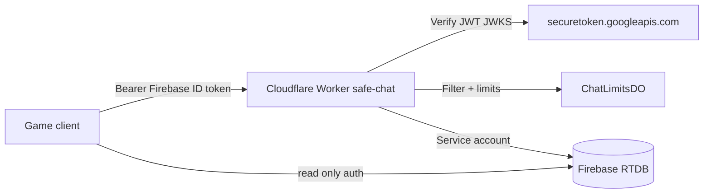

# Safe gang chat — implementation report (DRAFT PR)

## Architecture



- **Worker** (`workers/safe-chat/`): `POST /api/chat/send`, `POST /api/chat/report`, `GET /api/chat/config`, mod routes under `/api/mod/*`.
- **RTDB**: `chat/messages` read if `auth != null`; **all client writes denied**. Reports/mod/internal paths denied to clients.
- **Client** (`js/safe-chat.js`): reads `chat/messages`, sends via Worker when `window.__PUNK_SAFE_CHAT_URL` is set.

### Compatibility with PR #45

PR #45 adds `MINIMAL_CHAT_FOR_CLIENT` (auth read + client push on `chat/$msgId`). This PR **replaces** the `chat` subtree with `chat/messages` + server-only writes. See `scripts/lib/rtdb-safe-chat-patch.mjs` and `SAFE_CHAT_RULES_DELTA` in that file.

Presence / players rules from PR #45 are **not modified** except new optional fields `chatBlocklist`, `chatRegisteredAt` on `players/$uid`.

## Free tier choices (Cloudflare)

| Resource | Why |
|----------|-----|
| **Workers** (free) | ~100k requests/day — enough for small/medium gang chat if messages go through Worker only. |
| **Durable Objects** (free) | One `ChatLimitsDO` instance (`idFromName("global")`) holds per-UID cooldown + daily counters in DO storage. Avoids **KV free tier (1k writes/day)**, which is too low for per-message counters. |
| **Cron Triggers** (free) | Daily `0 4 * * *` retention job (7d messages, 90d reports). |

No Firebase Blaze, no paid moderation APIs.

## Secrets (owner sets at GO — **not done in this PR**)

```bash
cd workers/safe-chat
wrangler secret put FIREBASE_SERVICE_ACCOUNT_JSON   # JSON body, Database admin write
wrangler secret put MODERATOR_UIDS                  # e.g. uid1,uid2
# Optional after GO:
wrangler secret put SAFE_CHAT_WEBHOOK_URL           # new report notification
```

Enable free text when ready:

```bash
# wrangler.toml or dashboard var SAFE_CHAT_FREE_TEXT=true
```

Custom claim alternative: set `moderator: true` via Admin SDK (`scripts/set-admin-claim.mjs` pattern) — document only; do not run in this PR.

## Client enable (after deploy)

```html
<script>window.__PUNK_SAFE_CHAT_URL = "https://punk-me-safe-chat.<subdomain>.workers.dev";</script>
```

Until this is set, legacy `sendChat` RTDB push remains in code but **fails** once new rules are deployed.

## Files in this PR (product)

- `workers/safe-chat/**` — Worker, filter, phrases, wrangler.toml (placeholders)
- `scripts/lib/rtdb-safe-chat-patch.mjs`
- `database.rules.json` — safe chat rules overlay
- `js/safe-chat.js`, `js/safe-chat-i18n.js`, `js/game.js`, `index.html`, `css/game.css`
- `moderation.html`, `js/moderation.mjs`
- `docs/legal/CHAT_RULES.md`, `docs/legal/CHAT_PRIVACY.md`
- `scripts/run-safe-chat-tests.mjs`, `scripts/safe-chat-filter.test.js`, `scripts/test-safe-chat-rules.js`, `scripts/safe-chat-worker-logic.test.js`

Excluded: QA captures, secrets, player exports.

## Test matrix

| Case | Automated | Result |
|------|-----------|--------|
| Filter: homoglyphs / spaces / leet | `safe-chat-filter.test.js` | PASS (local) |
| Filter: links, email, phone, contact phrases | same | PASS |
| Filter: length > 200 | same | PASS |
| RTDB: client cannot POST `chat/messages` | `test-safe-chat-rules.js` + emulator | PASS (with emulator) |
| RTDB: client cannot POST legacy `chat/` | same | PASS |
| RTDB: auth can read `chat/messages` | same | PASS |
| RTDB: `chatBlocklist` self-write | same | PASS |
| Spam cooldown / daily limit | Durable Object | **Manual / staging** with Worker deploy |
| Reports → auto-hide at 3 | Worker + RTDB | **Manual / staging** |
| Mute / ban | mod API | **Manual / staging** |
| Mod panel forbidden for non-mod | mod API | **Manual / staging** |
| Retention 7/90d cron | `scheduled()` | **Manual** (time override in staging) |
| Preset phrases when `freeTextEnabled=false` | Worker config + client | **Manual** UI |
| Worker `/api/chat/config` smoke | `workers/safe-chat` vitest + miniflare | PASS (local) |
| Live JWT verification vs Google JWKS | Worker | **Manual** with real token |
| End-to-end game UI | Browser | **Manual** |

Run automated suite:

```bash
node scripts/run-safe-chat-tests.mjs
```

## Remaining risks

- Open-source wordlist is not complete; determined evasion possible → reports + mod tools.
- Single global DO: acceptable at free tier scale; shard if traffic grows.
- Legacy `chat/*` messages not migrated automatically.
- Ukrainian UI strings added for chat errors; full game `uk` locale not added.

## Owner GO checklist (do **not** execute in this PR)

1. Merge PR #45 (or deploy its rules) if not already live.
2. Merge this PR after review; deploy Worker (`wrangler deploy`) to owner account.
3. Set secrets (`FIREBASE_SERVICE_ACCOUNT_JSON`, `MODERATOR_UIDS`).
4. Deploy `database.rules.json` from this branch (after backup export).
5. Set `window.__PUNK_SAFE_CHAT_URL` on GitHub Pages / hosting config.
6. Legal review of `docs/legal/CHAT_RULES.md` and `CHAT_PRIVACY.md`.
7. Optionally enable `SAFE_CHAT_FREE_TEXT=true` when ready.
8. Optional: webhook for new reports.
