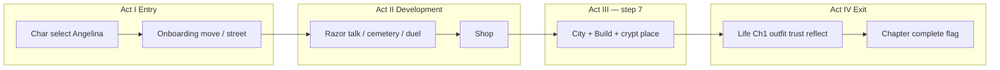

# Chapter 1 — Story arc map (current + proposed)

**t203u** · Audit against playable build on branch `cursor/vertical-slice-ch1-d81d`.

## Canon conflict (read first)

See `STORY_BIBLE.md`. Proposed four-act arc uses **Angelina-as-guide + separate player**. Approved **03.11** uses **player = Angelina**. Do not implement dual-POV until owner picks a reconciliation option.

---

## Act mapping — **what ships today**

| Act | Owner proposal | **Playable today** | Gap |
|-----|----------------|--------------------|-----|
| I Entry | Ruined city, vanishing memory | Room / home, 3D intro | No “forgotten city” narration |
| II Development | Districts, fragments | Street, cemetery, duel, shop | No memory fragments |
| III Crypt | Trial + open/keep secret | **Crypt placed on map** | No choice dialog; no vault lore |
| IV Exit | Force awakens, symbol | **Life Ch1 reflect** completes slice | No city-wide restoration beat |

## Onboarding order (tutorial = story order today)

1. Move (room)  
2. Street portal  
3. Talk Razor  
4. Cemetery  
5. Win fight  
6. Shop buy  
7. **City build — crypt** (material granted; `onCityBuildPlaced` advances)

Angelina guide banner tracks step index + Life Ch1 indices (`js/angelina-guide.mjs`).

## Life Ch1 narrative (approved content)

| Step | Id | Story beat |
|------|-----|------------|
| 0 | move | Embodied presence in room |
| 1 | outfit | Mirror — who am I today (style flags) |
| 2 | trust | Note at marker — trust Mira or not |
| 3 | reflect | Close loop; branch on flags |

**Ending today:** `lifeCh1.completed = true` — no cemetery finale in ordinary path automation.

---

## Proposed overlay — “Город, который забыл своё имя” (design only)

| Act | Proposal | Implementation status |
|-----|----------|----------------------|
| I | Angelina explains vanishing city | **Not written** — conflicts if Angelina addresses “you” |
| II | Six objects + fragments | **Not in data** |
| III | Crypt = memory vault; moral choice | **Gameplay:** crypt piece only; **story:** needs `dlg_city_crypt_*` (first-person) |
| IV | Symbol + Ch2 hook | **Not in build** |

### Recommended Phase 2 tasks (after owner POV decision)

1. Add `dlg_onboard_crypt_reveal` on first crypt place (first person, RU/EN/DA).  
2. Tie `LifeCh1Slice` finale line to “city remembers a name again.”  
3. Never gate crypt placement behind payment.

---

## Key scenes (storyboard index)

| # | Scene | Asset / location | Evidence |
|---|--------|------------------|----------|
| 1 | Cinematic / 3D room load | `index.html`, World3D | Desktop capture `onboarding_start` |
| 2 | Street + Razor | `street` | Capture scenes `onboarding_step_2` |
| 3 | City build crypt | `city`, `#btnBuild` | Capture `onboarding_step_6` (0-based = step 7) |
| 4 | Mirror wardrobe | Life Ch1 outfit | `ch1_mirror` |
| 5 | Trust choice | Life Ch1 dialog | `ch1_complete` |

Full script excerpts: `data/story/life-ch1-slice.json` + i18n onboarding keys.

---

## Chapters 2–5 (outline only)

| Ch | Hook |
|----|------|
| 2 | Who erased the city’s name? (requires Act IV hook) |
| 3 | District rebuild + antagonist pressure |
| 4 | Angelina’s past symbol |
| 5 | Season 1 convergence |

**Not approved** — placeholder for monetization continuity.

---

## Acceptance alignment (t203u)

- Ordinary path completes onboarding + Life Ch1 without dev URL cheats.  
- Step 7 crypt: **gameplay yes**; **proposed trial/reveal: no** (listed as limitation).  
- Angelina: **persistent banner** + Life Ch1 dialogs; **not** full character reactions on every action yet.
